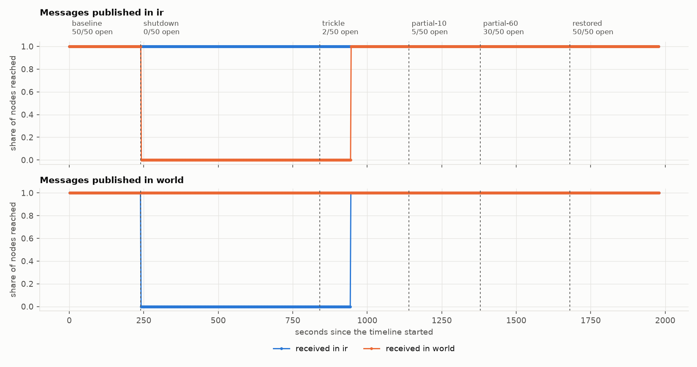

# cut-and-heal

Replay real internet outages against peer-to-peer messaging and measure what still gets delivered.

When a government shuts down the internet, it rarely goes fully dark. International links
are cut, the domestic network keeps running, and a small share of networks stay connected.
Restoration comes in steps over days. Peer-to-peer messaging is supposed to be what still
works in that situation. This tool tests that claim against the shape of outages that
actually happened.

It takes a documented outage, turns it into a timeline of border states, and replays that
timeline against a real gossipsub network on Kubernetes: hundreds of
[nim-libp2p](https://github.com/vacp2p/nim-libp2p) nodes, split into "inside" and "outside",
with every link shaped by `tc`. Then it reports what was delivered, to whom, how fast, and
how long the mesh took to adapt at each change.

```
public outage signal ──> scenario (regions, borders, timeline)
                               │
            ┌──────────────────┴───────────────────┐
            │  Kubernetes: one node per region      │
            │                                       │
            │  inside (pod CIDR A)   outside (B)    │
            │  ┌──────────────┐    ┌──────────────┐ │
            │  │ gossipsub    │    │ gossipsub    │ │   controller: one clock,
            │  │ node + shaper│<──>│ node + shaper│ │<─ fixed-rate publisher,
            │  └──────────────┘    └──────────────┘ │   raw evidence out
            └──────────────────┬───────────────────┘
                               │
        validity rules ──> results, or a withdrawn run with the reason
```

## What the first replay found

Iran, November 2019, replayed against 150 nodes (50 inside, 100 outside). Four valid runs.



- **Inside the country nothing was lost.** Through ten minutes with the border fully shut,
  every message published inside reached every inside node, with no dip at the cut.
- **Two open nodes in fifty carried everything.** With 2 of 50 inside nodes reconnected,
  100% of messages crossed in both directions.
- **But only after about 104 seconds.** Nothing crossed for 103 to 107 s after those two
  nodes reopened (64 s in one of eight measurements). I had predicted under 60.
- **The mesh took nine minutes to notice the cut.** Inside nodes reported an unchanged mesh
  for 535 to 574 s after the border shut.
- **A long cut loses what was sent during it; a short one does not.** Nothing published
  during the ten-minute shutdown ever crossed. After a 60-second cut, all of it did.
- **Crossing outward stayed about four times slower** until the border was fully open, even
  with 30 of 50 nodes reconnected.

Seven predictions were written down before the first run; five held and two were refuted.
The findings, the predictions, what they do not establish, and every withdrawn run are in
[reports/iran-2019-11](reports/iran-2019-11/README.md).

## What it measures

For every phase of an outage and every pair of regions:

- **Delivery**: the share of nodes each message reached, with a bootstrap interval.
- **Latency**: median and 99th percentile of delivered messages.
- **Settle time**: how long after each change delivery took to reach its new level.
- **Mesh and load**: mesh size per region, and how much traffic the few bridging nodes carry.

## How an outage becomes a test

The first scenario is Iran, November 2019: about five days with international traffic at
around 1% of normal while the domestic network stayed up, then restoration in steps.

`cah trace` fetches a public signal from [IODA](https://ioda.live), divides out the daily
cycle, and segments what is left into levels:

| Phase | Real window (UTC) | Cross-border traffic | Replayed as |
|---|---|---|---|
| baseline | before 16 Nov 19:00 | 100% | 50 of 50 inside nodes open |
| shutdown | 16 Nov to 21 Nov, 111 h | 0.7% to 1.9% | 0 of 50 |
| trickle | 21 Nov to 22 Nov, 34 h | 3.6% | 2 of 50 |
| partial-10 | 22 Nov to 23 Nov, 16 h | 9.5% | 5 of 50 |
| partial-60 | 23 Nov to 27 Nov, 99 h | 59% | 30 of 50 |
| restored | after 27 Nov 15:00 | 100% | 50 of 50 |

A border's depth is the number of nodes that still have it, not a packet loss rate. That is
closer to how a shutdown works, and it asks a sharper question: if two nodes in fifty can
still reach the outside, does the mesh carry messages to the other forty-eight?

The order and depth of the phases come from data. Link delays, region sizes and the mapping
from traffic share to open nodes are assumptions, stated in
[docs/METHOD.md](docs/METHOD.md) and varied in `scenarios/open-nodes-sweep.yaml`. Durations
are deliberately not kept: eleven days replay in 33 minutes.

## Design decisions

**Regions are Kubernetes nodes.** Each node owns a pod CIDR, so a region's pods share an
address range and the border is a real address boundary. Three `tc` filters classify all of
a pod's traffic, whatever the number of peers.

**The cut lands on the clock.** Every pod's shaper holds the whole timeline before the run
starts and applies each phase at an absolute time. With 150 pods on a 4-CPU machine, the
median shaper applied a phase 105 ms after schedule and the slowest 335 ms after. A cut that
arrives through a control plane lands on each pod at a different moment, and the transition
is the thing being measured.

**A partition drops both directions.** Dropping only a node's egress leaves TCP delivering
data to a node that merely stops acknowledging it. Closed nodes drop border traffic on
ingress too, and a test asserts that nothing crosses either way.

**The system under test is not ours.** Nodes run the Logos DST team's own
[regression test node](https://github.com/iftech/dst-libp2p-test-node), pinned by digest.
The shaper sidecar reuses the same image, which already ships `tc`.

**A run is believed only if it passes seven validity rules**, fixed before the runs they
judge. A leaking partition, a late shaper, an unhealthy baseline, a saturated host, a
stalled publisher, a restarted pod or truncated logs each void the run. Every rule has a
test that produces the fault and checks the rule fires.

**Evidence first, verdicts offline.** The controller collects raw logs and judges nothing.
`cah analyze` recomputes every number from those files.

**Published results come from public runs.** The *replay* workflow runs each seed on a fresh
cluster on a GitHub-hosted runner. A report names the workflow run that produced it, and
that run's artifacts hold the raw logs.

## Run it

Requirements: Docker, `kubectl`, Python 3.11 or newer, and a kernel with `sch_netem`.

```bash
pip install -e ".[report]"

cluster/up.sh ir world                       # K3s in Docker: a control node and one per region
export KUBECONFIG=$PWD/.kube/kubeconfig.yaml
cluster/load-image.sh cut-and-heal:dev

cah validate scenarios/iran-2019-11.yaml     # print the timeline
cah run scenarios/iran-2019-11.yaml --run-id iran-1 --seed 1 --controller-image cut-and-heal:dev
cah analyze runs/iran-1                      # validity verdicts, then results
cah report runs/iran-1 runs/iran-2 runs/iran-3 --out reports/iran-2019-11
```

On an existing cluster, label nodes instead of creating one:
`cut-and-heal/region=<name>` on the nodes of each region and `cut-and-heal/control=true` on
the node that hosts the controller and metrics. Each region needs its own pod CIDRs.

Build a scenario from another outage:

```bash
cah trace --country MM --start 2021-01-28 --end 2021-02-10 --baseline-days 3
```

## Tests

```bash
pytest                      # schema, tc plan compiler, analysis, each validity rule
bash tests/netem/run.sh     # real nodes, real shaper, real kernel: cut, one bridge, heal
```

CI also runs `scenarios/smoke.yaml` end to end on a throwaway K3s cluster and fails unless
the run is valid.

## Limits

This is emulation at the scale of hundreds of nodes on one machine. It shows how one
gossipsub implementation behaves under one model of an outage. It is not evidence that a
deployed network survives a real shutdown, where peer discovery, NAT, client behaviour and
an adversary who is trying all matter. The full list is in
[docs/METHOD.md](docs/METHOD.md#8-limits).

IODA's data is copyrighted by Georgia Tech and is not redistributed here. Scenarios carry
only the levels derived from it and the query that reproduces them.

## Related work

[10ksim](https://github.com/iftech/10ksim), the DST team's own toolkit, has a partition
experiment that splits a network into two halves with NetworkPolicies and heals it. This
project looks at a different part of the problem: outages shaped by real events, graded
rather than binary, with an asymmetric minority behind the border and a cut that is
synchronised by clock.

## Licence

MIT
