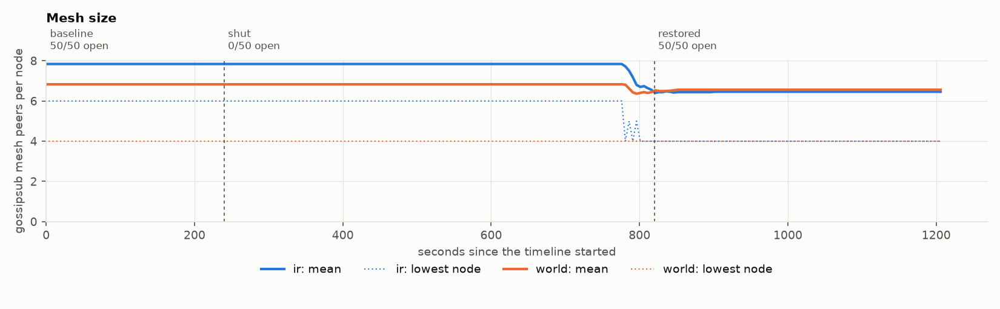

# Is a message sent into a shutdown lost, or only late? Findings

Gossipsub keeps no store of past messages beyond a few heartbeats. A message published while
a border is shut can only cross later if it waited in a connection that survived the cut.
[The long-cut report](../long-cut/README.md) found that a cut-off node keeps its connections
to dead peers until an idle check in nim-libp2p ends them, 5 to 10 minutes after its last
write. This experiment asks what that means for the messages.

Six scenarios differ only in how long the border stays shut: 60, 240, 420, 500, 580 and
720 s. The network is that of `long-cut`: 50 gossipsub nodes inside and 100 outside, default
kernel and node. The question and predictions are in
[METHOD.md section 14](../../docs/METHOD.md#14-follow-up-question-is-a-message-sent-into-a-shutdown-lost-or-only-late).

## Result

**A shutdown shorter than the idle check costs users only delay. A longer one loses almost
everything sent during it.** The line falls between 500 and 720 s, where the idle check
fires, and a run whose cut ended at 580 s caught the change half done.

Share of (message, node) pairs published during the shutdown that were delivered after the
border reopened, one value per valid run:

| Shutdown | Valid runs | Inside to outside | Outside to inside | Last delivery after reopening | Inside mesh first moved |
|---|---|---|---|---|---|
| 60 s | 3 of 3 | 100%, 100%, 100% | 100%, 100%, 100% | 47 to 49 s | never |
| 240 s | 2 of 3 | 100%, 100% | 100%, 100% | 14 to 101 s | never |
| 420 s | 1 of 6 | 100% | 100% | 61 s | never |
| 500 s | 2 of 3 | 100%, 100% | 97.2%, 98.8% | 34 to 102 s | never |
| 580 s | 1 of 3 | 84.1% | 54.0% | 32 s | 556 s |
| 720 s | 3 of 3 | 0%, 6.7%, 4.7% | 0%, 0%, 0% | 115 to 126 s | 548 to 565 s |

Messages published in the first 2 s of a shutdown are left out, since some were still in
flight when it landed.

## Predictions

All four were pushed before the runs.

| # | Prediction | Result |
|---|---|---|
| P21 | With 60, 240 and 420 s, at least 99% delivered later, in both directions | Held in all six valid runs: 100% |
| P22 | With 720 s, at most 1%, in both directions | **Refuted**: inside to outside, 6.7% and 4.7% in two of three runs |
| P23 | Inside to outside: at least 95% if the inside mesh had not moved by the reopening; at most 5% if it moved more than 60 s before | First half held in all eight runs it covers. Second half **failed** in one of three: 6.7% |
| P24 | Where at least 95% are delivered, the last arrives within 125 s of the reopening | Held: at most 102 s |

## What the runs showed

**1. A short shutdown loses nothing.** Up to 500 s, every message sent from inside during the
cut reached every outside node once the border reopened. The protocol needs no help for this:
the messages waited in TCP and in the multiplexer.

**2. They arrive within two minutes, in a burst.** After a 60 s cut the backlog arrived within
49 s; after 240 to 500 s, within 102 s. Linux retransmits an unanswered segment at
least every 120 s, so the next attempt after a long cut can be almost that far away.

**3. Past the idle check, almost everything is lost.** At 720 s nothing from outside crossed
in any run, and from inside 0 to 6.7%. Those few arrived 111 to 126 s after the reopening:
on connections the idle check had not yet ended, at the kernel's next retransmission. The
idle check does not end every connection at once, which is why P22 and P23 were too strict.

**4. The change is visible in a single run.** In the valid 580 s run the inside mesh first
moved 24 s before the border reopened. 84% of messages from inside and 54% from outside still
crossed: the connections were being closed while the cut ended.

## What this does not establish

- **Where exactly the line is.** It lies between 500 and 720 s for this network and these
  node ages, and moves with where the cut falls in the idle check's cycle (see long-cut).
- **Anything about heavier traffic.** One 1000-byte message a second. A busier link fills
  the multiplexer's 256 KB window sooner, which may change what survives.
- **Many runs at 420 and 580 s.** Five of six runs at 420 s and two of three at 580 s were
  withdrawn (see below). Their numbers are not used.
- **What an application above gossipsub does.** Messaging stacks can add their own
  retransmission. This measures the protocol alone: the loss such a layer has to recover.

## Why it matters

For a messaging network, the cost of an outage to its users is not set by the network. It
is set by a timer that was chosen to clean up idle connections, not to decide which messages
survive. Below it, users wait; above it, what they sent is gone. A reliability layer, such as
an end-to-end retransmission protocol on top of gossipsub, has to cover exactly the second
case, and this is the size of it: everything sent during an outage longer than about nine
minutes.

For testing: a partition test that heals within a few minutes will report no loss, and
that result says nothing about longer outages.

## Provenance

| Shutdown | Report | Evidence | Valid runs |
|---|---|---|---|
| 60 s | [cut-60](cut-60/report.md) | [replay run 43885781600](https://github.com/shanurwan/cut-and-heal/actions/runs/43885781600) | 3 of 3 |
| 240 s | [cut-240](cut-240/report.md) | [43885799644](https://github.com/shanurwan/cut-and-heal/actions/runs/43885799644) | 2 of 3 |
| 420 s | [cut-420](cut-420/report.md) | [43885818396](https://github.com/shanurwan/cut-and-heal/actions/runs/43885818396) (seeds 1 to 3), [43895019069](https://github.com/shanurwan/cut-and-heal/actions/runs/43895019069) (seeds 4 to 6) | 1 of 6 |
| 500 s | [cut-500](cut-500/report.md) | [43885836555](https://github.com/shanurwan/cut-and-heal/actions/runs/43885836555) | 2 of 3 |
| 580 s | [cut-580](cut-580/report.md) | [43885856668](https://github.com/shanurwan/cut-and-heal/actions/runs/43885856668) | 1 of 3 |
| 720 s | [cut-720](cut-720/report.md) | [43885872860](https://github.com/shanurwan/cut-and-heal/actions/runs/43885872860) | 3 of 3 |

One job, one fresh K3s cluster and one seed per run, on GitHub-hosted `ubuntu-24.04` runners
(4 CPUs). The held-message figures are in each report's `results.json` (`held_messages`),
produced by `cah report` on that evidence.

Every run that was started is listed: twenty-one runs, twelve valid. Of the nine withdrawn
runs, eight failed V5 (the publisher more than 50 ms late at the 99th percentile); five
failed V1 (a pod restarted), V3 and V7 together, two of them also V6. The runners were slower that day than on earlier days: the same kind of
workload kept the host about twice as busy (see
[METHOD.md section 20](../../docs/METHOD.md#20-reruns-on-17-november)). All three 420 s runs
of the first batch were withdrawn, so three more seeds were run; one of them is valid.
