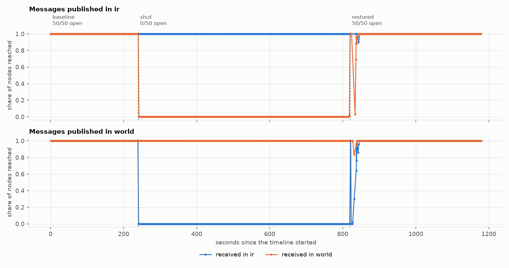
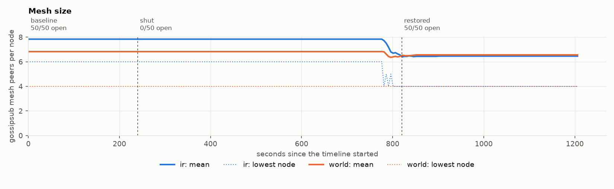

# A 580-second shutdown

## Setup

- 50 nodes in `ir`, 100 nodes in `world`; bootstrap node in `world`.
- Publish rate 1 msg/s, 1000 bytes, origins alternating between regions.
- System under test: `albertodst/regression-node-amd64:v2.4.0@sha256:fee857220664d269792f360734b9a819f0317dcfceeaa3edc3abd9c531a33988`.
- 3 run(s): `cut-length-580-seed1` (seed 1), `cut-length-580-seed2` (seed 2), `cut-length-580-seed3` (seed 3).
- A pair (message, receiving node) counts as delivered within 10 s. Steady-state figures cover the last 50% of each phase.

## Validity

| Rule | `cut-length-580-seed1` | `cut-length-580-seed2` | `cut-length-580-seed3` |
|---|---|---|---|
| V1 The run completed on the intended topology, with no pod restarts | pass | **FAIL** | pass |
| V2 Every pod applied every phase, on schedule | pass | pass | pass |
| V3 The network was healthy before anything was cut (>= 0.99) | pass | **FAIL** | pass |
| V4 No message was received across a border while it had no open node | pass | pass | pass |
| V5 The publisher kept its schedule and reached the nodes | pass | **FAIL** | **FAIL** |
| V6 The host had CPU headroom throughout (p95 busy <= 85%) | pass | **FAIL** | pass |
| V7 The evidence is complete and two records of it agree | pass | **FAIL** | **FAIL** |

Run `cut-length-580-seed2` is withdrawn and contributes no numbers. V1: status=completed; 150/150 pods at end, 2 restarted, 0 not running; V3: lowest baseline delivery 0.9592; V5: 1180 publishes, send lateness p99 214 ms, 2 never reached a node, 0 refused by the node for having no peers (an outcome, not a fault); V6: CPU busy p50 39%, p95 94%, max 100% over 246 samples; V7: 1178 publishes reconciled against 1162 node send lines; 2954 receive lines for messages nobody logged sending; 2 pods where the controller and the node disagree on messages sent

Run `cut-length-580-seed3` is withdrawn and contributes no numbers. V5: 1180 publishes, send lateness p99 70 ms, 1 never reached a node, 0 refused by the node for having no peers (an outcome, not a fault); V7: 1179 publishes reconciled against 1180 node send lines; 1 pods where the controller and the node disagree on messages sent

## Delivery in steady state

Share of (message, node) pairs delivered, mean of 1 valid run(s) with the range across runs. *no path* marks a pair of regions with no open border between them in that phase. *late* is the share that arrived after the 10 s deadline, for example once a border reopened.

| Phase | Border | ir to ir | ir to world | world to ir | world to world |
|---|---|---|---|---|---|
| baseline | 50/50 open | 100.00% | 100.00% | 100.00% | 100.00% |
| shut | 0/50 open | 100.00% | 0.00%, 82.9% late *(no path)* | 0.00%, 52.1% late *(no path)* | 100.00% |
| restored | 50/50 open | 100.00% | 100.00% | 100.00% | 100.00% |

## Latency of delivered pairs

Median / 99th percentile, milliseconds, steady state.

| Phase | ir to ir | ir to world | world to ir | world to world |
|---|---|---|---|---|
| baseline | 30 / 62 | 143 / 217 | 132 / 204 | 74 / 237 |
| shut | 28 / 59 | n/a / n/a | n/a / n/a | 72 / 188 |
| restored | 30 / 67 | 181 / 258 | 141 / 185 | 74 / 207 |

## Time to settle after each change

Seconds from the start of a phase to the last message whose delivery was more than 1% below that phase's steady level. One value per valid run.

| Phase | ir to ir | ir to world | world to ir | world to world |
|---|---|---|---|---|
| shut | 0 | no path | no path | 0 |
| restored | 23.14 | 20.45 | 23.72 | 17.64 |

## When the mesh noticed

Seconds after each change until a region's mean mesh size first moved by more than 10%. One value per valid run; *never* means it stayed within 10% for the whole phase. The size is what each node reports about itself, so it includes peers the node has not yet found to be unreachable.

| Phase | Region | Mesh size at start | at end | Reacted after (s) |
|---|---|---|---|---|
| shut | ir | 7.8 | 6.6 | 556 |
| shut | world | 6.8 | 6.4 | never |
| restored | ir | 6.4 | 6.5 | never |
| restored | world | 6.5 | 6.6 | never |

## Messages sent while a border was shut

Of the messages published in one region while it had no path to another, the share of (message, node) pairs in the other region delivered by the end of the run, and when, in seconds after the path reopened. The last column is when the sending region's mean mesh first moved by more than 10% during the shutdown, if it did.

| Run | Phase | From | To | Shut (s) | Messages | Delivered later | First (s) | Median (s) | Last (s) | Sender's mesh moved after (s) |
|---|---|---|---|---|---|---|---|---|---|---|
| cut-length-580-seed1 | shut | ir | world | 580 | 289 | 84.08% | 0.6 | 10.1 | 28.9 | 556 |
| cut-length-580-seed1 | shut | world | ir | 580 | 289 | 53.98% | 0.7 | 20.1 | 32.2 | never |

## Mesh reaction against node age

For the pods whose own mesh fell below its size at the start of the phase: the median moment of that first fall, counted from the change and from the start of the pod's node. A reaction tied to the change keeps the first number from run to run; one tied to a clock that began with the node keeps the last.

| Run | Phase | Region | Pods | After the change (s) | Node age at the change (s) | Node age at the fall (s) |
|---|---|---|---|---|---|---|
| cut-length-580-seed1 | shut | ir | 44 | 553 | 372 | 920 |

## Stream idle timeouts when the mesh moved

Multiplexer streams the region's nodes closed for inactivity, from the nodes' own counter `libp2p_stream_timeouts`: from 25 s before the region's mean mesh first moved to 5 s after, and earlier in the same phase.

| Run | Phase | Region | Mesh moved after (s) | Timeouts around it | Earlier in the phase |
|---|---|---|---|---|---|
| cut-length-580-seed1 | shut | ir | 556 | 2343 | 8912 |

## Bursts of stream idle timeouts

Stretches in which a region's nodes closed multiplexer streams for inactivity, from the same counter. A burst ends after 60 s without a timeout; bursts of fewer than 100 are left out. Seconds after the phase began.

| Run | Phase | Region | From (s) | To (s) | Peak (s) | Timeouts |
|---|---|---|---|---|---|---|
| cut-length-580-seed1 | shut | ir | 246 | 351 | 276 | 8816 |
| cut-length-580-seed1 | shut | ir | 536 | 576 | 556 | 3224 |
| cut-length-580-seed1 | restored | ir | 1 | 26 | 16 | 1460 |
| cut-length-580-seed1 | restored | ir | 261 | 341 | 321 | 498 |
| cut-length-580-seed1 | shut | world | 246 | 351 | 341 | 10703 |
| cut-length-580-seed1 | shut | world | 536 | 576 | 556 | 3030 |
| cut-length-580-seed1 | restored | world | 1 | 71 | 1 | 2714 |
| cut-length-580-seed1 | restored | world | 256 | 351 | 326 | 647 |

## Kernel TCP settings on the nodes

Read by each pod's shaper from the pod's own network namespace when it started. Pods per value, one column per valid run.

| Setting | cut-length-580-seed1 |
|---|---|
| tcp_keepalive_time | 7200 (150 pods) |
| tcp_retries2 | 15 (150 pods) |

## Figures

From run `cut-length-580-seed1`.

