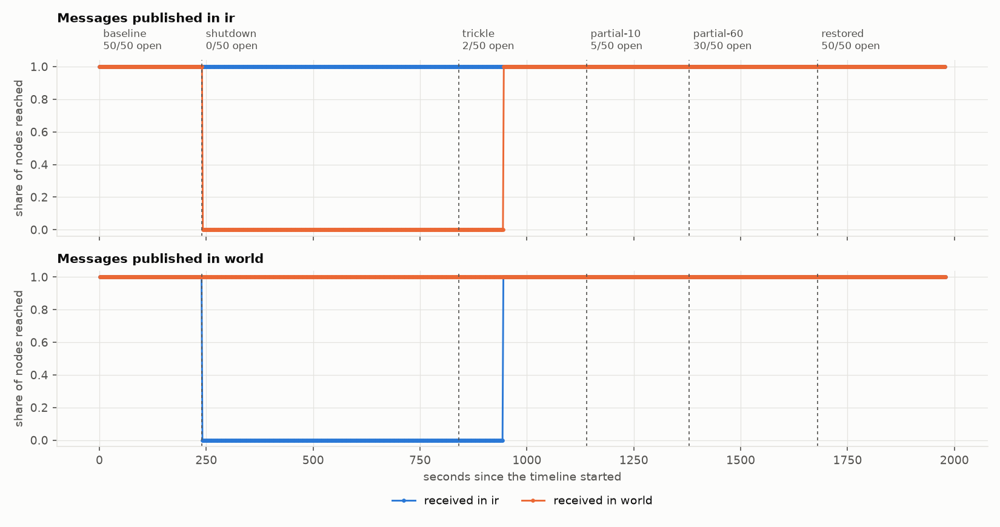
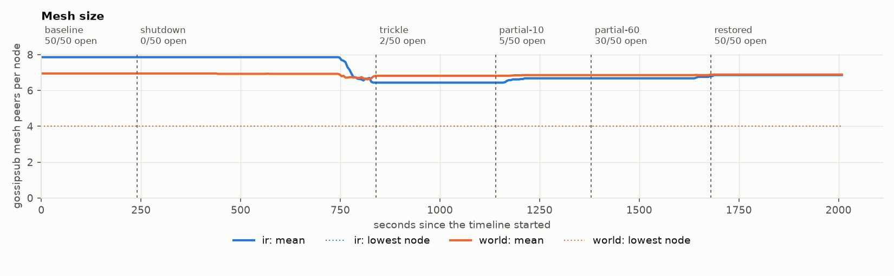

# Iran, November 2019: findings

Five replicate runs of [`scenarios/iran-2019-11.yaml`](../../scenarios/iran-2019-11.yaml):
50 gossipsub nodes inside, 100 outside, 1 message per second, 33 minutes each. Four runs
passed every validity rule and one was withdrawn. The generated tables and figures are in
[report.md](report.md); this page says what they show.

The system under test is nim-libp2p as packaged in the DST regression node, image
`albertodst/regression-node-amd64:v2.4.0`, pinned by digest, with the parameters that image
ships.

## What happened

**1. Inside the country, nothing was lost.** Through ten minutes with the border fully shut,
every message published inside reached every other inside node, at the same latency as
before (median 30 ms against 32 ms). There was no dip at the moment of the cut in any run.

**2. Two open nodes in fifty were enough, eventually.** With 2 of 50 inside nodes
reconnected, 100% of messages crossed the border in both directions, to all 50 inside nodes
and all 100 outside. Opening 5 or 30 changed nothing further in delivery.

**3. "Eventually" was about 104 seconds.** After the two nodes reopened, no message crossed
for 103 to 107 s in seven of eight measurements (64 s in the eighth). Then delivery went from
0% to 100% abruptly. The later steps, to 5, 30 and 50 open nodes,
had no such gap: once any path existed, widening it was seamless.

**4. The mesh took nine minutes to notice the cut.** Inside nodes reported the same mesh
size for 535 to 574 s after the border shut, then dropped from 7.8 to 6.4 peers. Delivery
inside was unaffected throughout, so this did no damage here, but for nine minutes each
inside node's mesh was counting peers it could not reach.

**5. A long cut loses what was sent during it; a short one does not.** No message published
during the ten-minute shutdown ever crossed the border, before or after it reopened. In the
60-second cut of the smoke scenario, every one of them arrived once the border reopened,
late but complete ([CI run](https://github.com/shanurwan/cut-and-heal/actions/runs/42884684468)).
Somewhere between one and ten minutes, the connections that were holding those messages
gave up.

**6. Crossing outward stayed slow after the border was mostly open.** Median latency from
inside to outside was 144 ms before the shutdown. It was 645 ms with 2 nodes open, 617 ms
with 5, and still 542 ms with 30 of 50 open. It returned to 181 ms only at full restoration.
The other direction went from 131 ms to about 165 ms. The asymmetry is consistent across
all four runs.

**7. Bridging nodes were not crushed.** The two nodes carrying all cross-border traffic sent
1.2 to 1.8 times the bytes of their neighbours, not many times more.

## Predictions

Written in [docs/METHOD.md](../../docs/METHOD.md#6-predictions) before the first run.

| # | Prediction | Result |
|---|---|---|
| P1 | Inside-to-inside delivery stays at or above 99% during the shutdown | Held: 100% in all four runs |
| P2 | Inside-to-inside delivery settles within 10 s of the cut | Held: no message below the steady level |
| P3 | Outside-to-outside delivery stays at or above 99% in every phase | Held: 100% |
| P4 | Cross-border delivery resumes within 60 s of two nodes reopening | **Refuted**: 64 to 107 s |
| P5 | With 2 of 50 open, at least 95% crosses in both directions | Held: 100% |
| P6 | Bridging nodes send at least 3 times the median bytes of the others | **Refuted**: 1.2 to 1.8 times |
| P7 | Every pair is back at or above 99% within 60 s of full restoration | Held: no message below the steady level |

## What this does not establish

- **Why** recovery takes 104 s, why the mesh holds for nine minutes, or why the outward
  direction stays slow. The timings are consistent with connection timeouts, a reconnect
  interval, and delivery by gossip pull instead of mesh push, in that order. None of those
  was verified against the node's source or with a second experiment, so they are leads, not
  causes.
- **Whether two nodes are special.** `scenarios/open-nodes-sweep.yaml` holds the border at
  1, 2 and 5 open nodes after identical shutdowns. It has not been run for this report.
- **Anything at the scale of a public network.** These are 150 nodes on one 4-CPU machine.
- **Anything about a real shutdown** beyond its shape. See the limits in the method.

## Provenance

| | |
|---|---|
| Evidence | [replay run 42900236972](https://github.com/shanurwan/cut-and-heal/actions/runs/42900236972): one job, one fresh K3s cluster and one seed per run, on GitHub-hosted `ubuntu-24.04` runners (4 CPUs) |
| Raw logs | Artifacts of that workflow run, one per seed: node logs, shaper logs, acknowledgements, publish record, host load and metric exports |
| Report | `cah report` on that evidence; every number is in [results.json](results.json) |
| Reproduce | Actions, *replay*, scenario `iran-2019-11`, seeds `[1, 2, 3, 4, 5]` |

## Withdrawn runs

Every run that was started is listed here.

| Workflow run | Runs | Outcome |
|---|---|---|
| [42886058240](https://github.com/shanurwan/cut-and-heal/actions/runs/42886058240) | seeds 1, 2, 3 | All withdrawn under V2. Shapers applied phases up to 1,950 ms late (limit 500 ms). Led to the shaper forking once per phase. |
| [42893228456](https://github.com/shanurwan/cut-and-heal/actions/runs/42893228456) | seeds 1, 2, 3 | Seeds 1 and 3 withdrawn under V2 (up to 1,784 ms late). Seed 2 passed every rule; it is not in this report because it ran an earlier shaper than the others. Led to the fork-free wake-up. |
| [42900236972](https://github.com/shanurwan/cut-and-heal/actions/runs/42900236972) | seeds 1 to 5 | Seeds 1 to 4 valid, shapers at most 335 ms late. Seed 5 withdrawn under V2: 628 ms. |

The V2 limit was set before any of these runs and was not changed. In the valid runs the
median shaper applied a phase 105 ms after schedule and the slowest 280 to 335 ms after.
