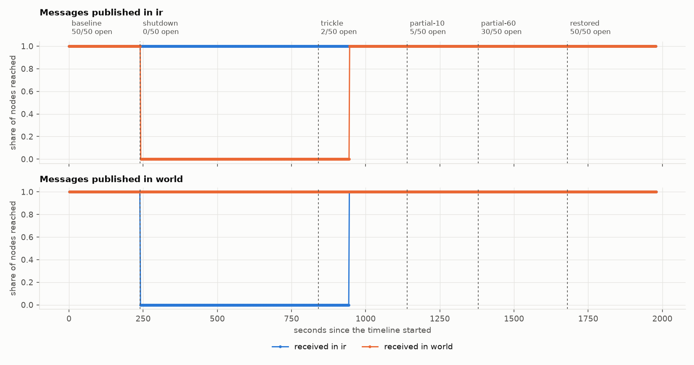
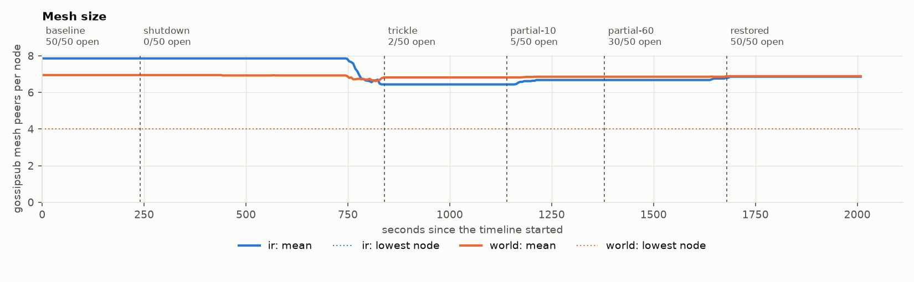
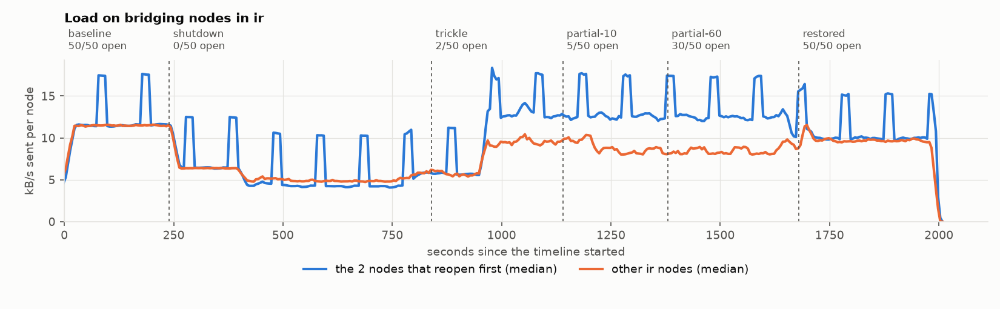

# Iran, November 2019 - international shutdown with a live domestic network

**Event.** Nationwide international internet shutdown, Iran, 16-27 November 2019

**Signal.** IODA gtr-norm (traffic to Google services, normalised), country IR ([view](https://ioda.live/country/IR?from=1573603200&until=1575590400)), window 2019-11-13 to 2019-12-06 UTC, retrieved 2026-11-10.

**Derivation.** cah trace --country IR --start 2019-11-13 --end 2019-12-06 --baseline-days 3. Each sample is divided by the median of the same half-hour slot over 13-15 November, then segmented at levels 0, 0.02, 0.1, 0.5, 1. The 111 hours from 16 Nov 19:00 UTC sat between 0.7% and 1.9% and are replayed as one phase.

## Setup

- 50 nodes in `ir`, 100 nodes in `world`; bootstrap node in `world`.
- Publish rate 1 msg/s, 1000 bytes, origins alternating between regions.
- System under test: `albertodst/regression-node-amd64:v2.4.0@sha256:fee857220664d269792f360734b9a819f0317dcfceeaa3edc3abd9c531a33988`.
- 5 run(s): `iran-2019-11-seed1` (seed 1), `iran-2019-11-seed2` (seed 2), `iran-2019-11-seed3` (seed 3), `iran-2019-11-seed4` (seed 4), `iran-2019-11-seed5` (seed 5).
- A pair (message, receiving node) counts as delivered within 10 s. Steady-state figures cover the last 50% of each phase.

## Validity

| Rule | `iran-2019-11-seed1` | `iran-2019-11-seed2` | `iran-2019-11-seed3` | `iran-2019-11-seed4` | `iran-2019-11-seed5` |
|---|---|---|---|---|---|
| V1 The run completed on the intended topology, with no pod restarts | pass | pass | pass | pass | pass |
| V2 Every pod applied every phase, on schedule | pass | pass | pass | pass | **FAIL** |
| V3 The network was healthy before anything was cut (>= 0.99) | pass | pass | pass | pass | pass |
| V4 No message was received across a border while it had no open node | pass | pass | pass | pass | pass |
| V5 The publisher kept its schedule and reached the nodes | pass | pass | pass | pass | pass |
| V6 The host had CPU headroom throughout (p95 busy <= 85%) | pass | pass | pass | pass | pass |
| V7 The evidence is complete and two records of it agree | pass | pass | pass | pass | pass |

Run `iran-2019-11-seed5` is withdrawn and contributes no numbers. V2: lateness p50 108 ms, p99 387 ms, max 628 ms over 900 applications; shaper off schedule (limit 500 ms)

## Delivery in steady state

Share of (message, node) pairs delivered, mean of 4 valid run(s) with the range across runs. *no path* marks a pair of regions with no open border between them in that phase. *late* is the share that arrived after the 10 s deadline, for example once a border reopened.

| Phase | Border | ir to ir | ir to world | world to ir | world to world |
|---|---|---|---|---|---|
| baseline | 50/50 open | 100.00% | 100.00% | 100.00% | 100.00% |
| shutdown | 0/50 open | 100.00% | 0.00% *(no path)* | 0.00% *(no path)* | 100.00% |
| trickle | 2/50 open | 100.00% | 100.00% | 100.00% | 100.00% |
| partial-10 | 5/50 open | 100.00% | 100.00% | 100.00% | 100.00% |
| partial-60 | 30/50 open | 100.00% | 100.00% | 100.00% | 100.00% |
| restored | 50/50 open | 100.00% | 100.00% | 100.00% | 100.00% |

## Latency of delivered pairs

Median / 99th percentile, milliseconds, steady state.

| Phase | ir to ir | ir to world | world to ir | world to world |
|---|---|---|---|---|
| baseline | 32 / 68 | 144 / 240 | 131 / 202 | 80 / 253 |
| shutdown | 30 / 60 | n/a / n/a | n/a / n/a | 72 / 189 |
| trickle | 30 / 65 | 645 / 748 | 169 / 573 | 73 / 200 |
| partial-10 | 30 / 63 | 617 / 728 | 165 / 501 | 72 / 188 |
| partial-60 | 30 / 63 | 542 / 723 | 162 / 509 | 73 / 202 |
| restored | 31 / 66 | 181 / 270 | 141 / 190 | 74 / 213 |

## Time to settle after each change

Seconds from the start of a phase to the last message whose delivery was more than 1% below that phase's steady level. One value per valid run.

| Phase | ir to ir | ir to world | world to ir | world to world |
|---|---|---|---|---|
| shutdown | 0, 0, 0, 0 | no path | no path | 0, 0, 0, 0 |
| trickle | 0, 0, 0, 0 | 104, 104, 106, 64 | 103, 103, 107, 105 | 0, 0, 0, 0 |
| partial-10 | 0, 0, 0, 0 | 0, 0, 0, 0 | 0, 0, 0, 0 | 0, 0, 0, 0 |
| partial-60 | 0, 0, 0, 0 | 0, 0, 0, 0 | 0, 0, 0, 0 | 0, 0, 0, 0 |
| restored | 0, 0, 0, 0 | 0, 0, 0, 0 | 0, 0, 0, 0 | 0, 0, 0, 0 |

## When the mesh noticed

Seconds after each change until a region's mean mesh size first moved by more than 10%. One value per valid run; *never* means it stayed within 10% for the whole phase. The size is what each node reports about itself, so it includes peers the node has not yet found to be unreachable.

| Phase | Region | Mesh size at start | at end | Reacted after (s) |
|---|---|---|---|---|
| shutdown | ir | 7.8 | 6.4 | 538, 535, 543, 574 |
| shutdown | world | 7.2 | 6.6 | never, never, 588, 584 |
| trickle | ir | 6.4 | 6.5 | never, never, never, never |
| trickle | world | 6.6 | 6.6 | never, never, never, never |
| partial-10 | ir | 6.5 | 6.5 | never, never, never, never |
| partial-10 | world | 6.6 | 6.7 | never, never, never, never |
| partial-60 | ir | 6.5 | 6.7 | never, never, never, never |
| partial-60 | world | 6.7 | 6.7 | never, never, never, never |
| restored | ir | 6.7 | 6.7 | never, never, never, never |
| restored | world | 6.7 | 6.7 | never, never, never, never |

## Load on the nodes that keep the border

Median bytes sent per second in steady state: nodes with the border open against the other nodes of their region. One row per valid run.

| Phase | Open nodes | Open nodes (B/s) | Other nodes (B/s) | Ratio |
|---|---|---|---|---|
| trickle | 2 | 13668 | 10100 | 1.35 |
| trickle | 2 | 14306 | 10587 | 1.35 |
| trickle | 2 | 12788 | 10628 | 1.2 |
| trickle | 2 | 18845 | 10640 | 1.77 |
| partial-10 | 5 | 9734 | 8375 | 1.16 |
| partial-10 | 5 | 9410 | 8032 | 1.17 |
| partial-10 | 5 | 9275 | 7623 | 1.22 |
| partial-10 | 5 | 8762 | 7673 | 1.14 |
| partial-60 | 30 | 9138 | 8670 | 1.05 |
| partial-60 | 30 | 9493 | 7519 | 1.26 |
| partial-60 | 30 | 7993 | 8654 | 0.92 |
| partial-60 | 30 | 8531 | 7380 | 1.16 |

## Figures

From run `iran-2019-11-seed1`.

