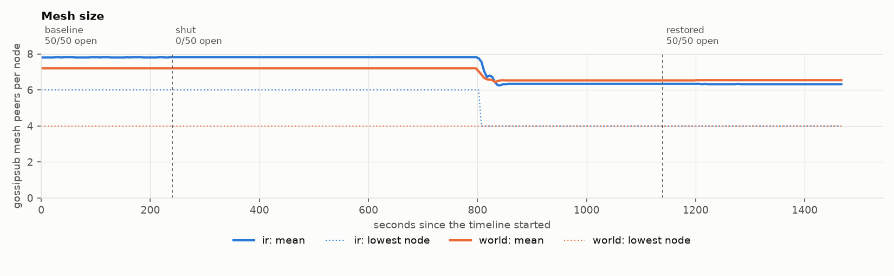
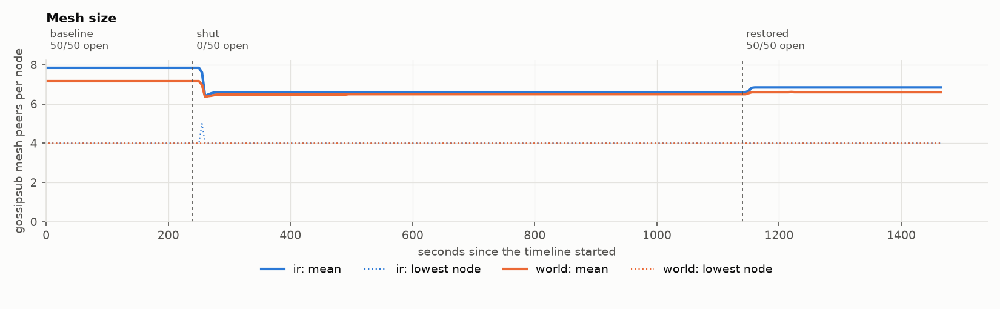

# What sets the nine minutes? Findings

In the [Iran runs](../iran-2019-11/README.md), nodes cut off from the rest of the network
kept their pre-cut mesh size for about nine minutes. That report listed a connection timeout
as a lead and did not test it. This one does.

Two scenarios that differ in one setting, three seeds each, 50 gossipsub nodes inside and
100 outside, one full shutdown held for 15 minutes:

- [`long-cut`](../../scenarios/long-cut.yaml): kernel defaults for TCP.
- [`long-cut-short-timeout`](../../scenarios/long-cut-short-timeout.yaml): the same, with
  `net.ipv4.tcp_retries2` set to 5 on every node.

All six runs passed every validity rule. The hypothesis and both predictions were written in
[docs/METHOD.md, section 10](../../docs/METHOD.md#10-follow-up-question-what-sets-the-nine-minutes)
and pushed before either scenario was run. Generated tables and figures:
[default](default/report.md), [short timeout](short-timeout/report.md).

## Result

**The kernel's TCP retransmission limit sets how long a cut-off node keeps a dead peer in
its mesh.** Lowering that one limit moved the reaction from about nine and a half minutes to
about twenty seconds.

Seconds after the cut until the inside region's mean mesh size first moved by more than 10%:

| | seed 1 | seed 2 | seed 3 |
|---|---|---|---|
| Default timers | 577 | 572 | 537 |
| `tcp_retries2 = 5` | 20 | 22 | 19 |

| # | Prediction | Result |
|---|---|---|
| P8 | With default timers, the inside mesh first moves between 480 and 660 s after the cut | Held: 537 to 577 s in all three runs |
| P9 | With 5 retransmissions, it first moves within 120 s of the cut | Held: 19 to 22 s in all three runs |

So nothing above TCP noticed the cut sooner. For as long as the kernel kept retransmitting
into a link that dropped every packet, the node counted the peer as a mesh member.

## What else the runs showed

**1. Delivery inside did not depend on it.** In both arms every message published inside
reached every inside node throughout the shutdown, and the same held outside. A mesh that
counts dead peers for nine minutes did no damage to delivery here.

**2. Nothing sent during a 15-minute cut crossed later, in either arm.** None of the 67,500
(message, node) pairs published across the closed border in each run was delivered after it
reopened. This agrees with the ten-minute cut of the Iran runs.

**3. Recovery was immediate in both arms.** With all 50 nodes reopened at once, no message
after the reopening fell below the steady level.

**4. The network came back faster after a short timeout.** In the five minutes after
restoration, median latency from inside to outside was 286 ms with default timers and 185 ms
with the short timeout, against 142 ms before the cut. From outside to inside it was 241 ms
and 143 ms, against 131 ms before. This was not predicted, so it is an observation from three runs per arm and
not a tested claim.

## What this does not establish

- **Which default the nodes actually had.** Fifteen retransmissions, the documented Linux
  default, give up after about 925 s at the kernel's minimum timeout. The default arm reacted
  at 537 to 577 s, which is what twelve would give (565 s). The runs did not record the value
  inside the pods, so the limit governs the delay, but the effective default on these runners
  is unverified.
- **Which nim-libp2p code path reacts** when the connection closes, or whether the node has
  a keepalive that could be enabled. The node's source was not read for this report.
- **That a NetworkPolicy cut behaves the same.** A policy that rejects packets, or a CNI
  that resets connections, would end them at once. This is a silent drop by netem.
- **That a shorter timeout is better.** It also closes connections sooner on a link that is
  only slow. No lossy-but-alive scenario was run with it.
- **Anything at the scale of a public network.** These are 150 nodes on one 4-CPU machine.

## Why it matters for testing

A partition test that heals after two minutes ends long before a node with default timers
has noticed anything. Mesh size, peer counts and connection counts read as healthy for the
whole split. To observe the reaction, either hold the split past the kernel's timeout or
lower the timeout, and say which was done.

## Provenance

| | |
|---|---|
| Evidence | default: [replay run 43596346549](https://github.com/shanurwan/cut-and-heal/actions/runs/43596346549); short timeout: [replay run 43596356535](https://github.com/shanurwan/cut-and-heal/actions/runs/43596356535). One job, one fresh K3s cluster and one seed per run, on GitHub-hosted `ubuntu-24.04` runners (4 CPUs) |
| Setting | Applied through each pod's security context; the kubelet refuses a pod whose setting it does not allow, and every pod of every run started. The rendered manifests are in each run's artifact |
| Report | `cah report` on that evidence; every number is in each arm's `results.json` |
| Reproduce | Actions, *replay*, scenarios `long-cut` and `long-cut-short-timeout`, seeds `[1, 2, 3]` |

Every run that was started is listed here: six runs, six valid, none withdrawn.
