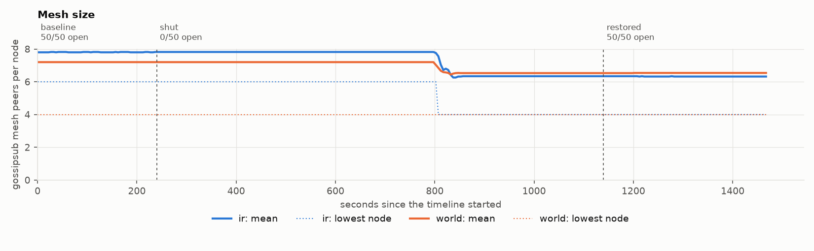
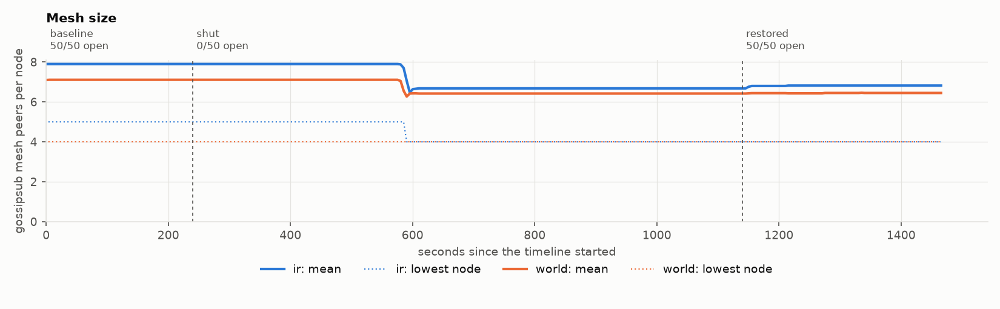
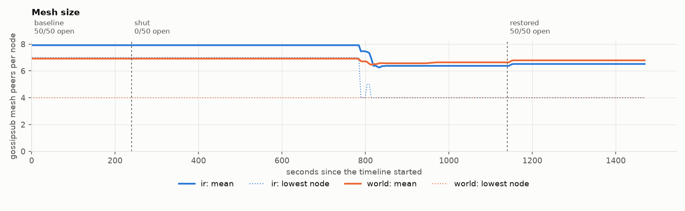

# What sets the nine minutes? Findings

In the [Iran runs](../iran-2019-11/README.md), nodes cut off from the rest of the network
kept their pre-cut mesh size for about nine minutes. That report listed a connection timeout
as a lead and did not test it. This one does, in two experiments.

Every scenario here is the same network: 50 gossipsub nodes inside and 100 outside, one full
shutdown held for 15 minutes. The arms differ in one kernel setting,
`net.ipv4.tcp_retries2`, the number of times the kernel retransmits unanswered data before
it closes a connection.

## Result

**Two timers, not one.** Below about nine minutes, a cut-off node drops a dead peer when the
kernel closes the TCP connection, and at no other time. At about nine minutes something else
ends the connection, whatever the kernel's limit. With default settings it is this second
timer that a node waits for, not the kernel.

Seconds after the cut until the inside region's mean mesh size first moved by more than 10%,
one value per valid run, against the time at which the kernel closes a connection that gets
no answer:

| `tcp_retries2` | Kernel closes after | Inside mesh first moved after |
|---|---|---|
| 5 | 12.6 s | 20, 22, 19 |
| 8 | 102.2 s | 119, 116 |
| 10 | 324.6 s | 350, 352, 351 |
| 13 | 684.6 s | 574, 582, 554 |
| 15 (default) | 924.6 s | 577, 572, 537, 492 |

At 5, 8 and 10 the mesh follows the kernel, 6 to 27 s behind it. At 13 and 15 it moves
between 492 and 582 s, 100 to 430 s before the kernel would have closed anything.

The kernel's column is its backoff rule: the retransmission timeout doubles from 200 ms, is
capped at 120 s, and the connection is closed once the time since the first retransmission
reaches the total for `tcp_retries2` retransmissions and the wait after the last.

## How it was found

**First experiment** ([METHOD.md section 10](../../docs/METHOD.md#10-follow-up-question-what-sets-the-nine-minutes)):
defaults against 5 retransmissions, three seeds each.

| # | Prediction | Result |
|---|---|---|
| P8 | With default timers, the inside mesh first moves between 480 and 660 s after the cut | Held: 537 to 577 s |
| P9 | With 5 retransmissions, it first moves within 120 s of the cut | Held: 19 to 22 s |

The first version of this report concluded from those two arms that the kernel's limit sets
the nine minutes. That was too strong. It listed as unverified which default the pods had,
and noted that 15 retransmissions should take about 925 s, not 560. A connection measured on
its own, outside this project, then closed after 951 s at the default. The conclusion could
not stand as written.

**Second experiment** ([METHOD.md section 11](../../docs/METHOD.md#11-follow-up-question-is-the-kernel-the-only-timer)):
the shaper in every pod now records the pod's own `tcp_retries2`, and three arms were added
at 8, 10 and 13, with the default run once more to record its value.

| # | Prediction | Result |
|---|---|---|
| P10 | Default pods record 15; each arm records the value it set | Held: all 150 pods in each of ten runs |
| P11 | With 8, the inside mesh first moves 100 to 140 s after the cut | Held: 116 and 119 s |
| P12 | With 10, 320 to 360 s | Held: 350 to 352 s |
| P13 | With 13, 530 to 590 s: the same as defaults, and before the kernel would close | Held: 554 to 582 s |

All predictions of both experiments were pushed before the runs they describe.

## What else the runs showed

These come from the first experiment's two arms.

**1. Delivery inside did not depend on it.** In both arms every message published inside
reached every inside node throughout the shutdown, and the same held outside. A mesh that
counts dead peers for nine minutes did no damage to delivery here.

**2. Nothing sent during a 15-minute cut crossed later, in either arm.** None of the 67,500
(message, node) pairs published across the closed border in each run was delivered after it
reopened. This agrees with the ten-minute cut of the Iran runs.

**3. Recovery was immediate in both arms.** With all 50 nodes reopened at once, no message
after the reopening fell below the steady level.

**4. The network came back faster after a short timeout.** In the five minutes after
restoration, median latency from inside to outside was 286 ms with default timers and 185 ms
with 5 retransmissions, against 142 ms before the cut. From outside to inside it was 241 ms
and 143 ms, against 131 ms before. This was not predicted, so it is an observation from
three runs per arm and not a tested claim.

## What this does not establish

- **What the second timer is.** Something ends these connections 492 to 582 s after a
  silent cut. Candidates are a keepalive or ping in the node's stream multiplexer and the
  gossipsub peer score. The node's source was not read for this report, and no run varied
  either.
- **Why the default arm varies more.** Its four runs span 492 to 577 s; the arm at 10 spans
  2 s. A timer with a fixed period would not spread like that, so the second mechanism may
  depend on when each connection last carried data.
- **That a NetworkPolicy cut behaves the same.** A policy that rejects packets, or a CNI
  that resets connections, would end them at once. This is a silent drop by netem.
- **That a shorter timeout is better.** It also closes connections sooner on a link that is
  only slow. No lossy-but-alive scenario was run with it.
- **Anything at the scale of a public network.** These are 150 nodes on one 4-CPU machine.

## Why it matters for testing

A partition test that heals after two minutes ends long before a node with default timers
has noticed anything. Mesh size, peer counts and connection counts read as healthy for the
whole split. To observe the reaction, either hold the split past nine minutes or lower
`tcp_retries2`, and say which was done. Lowering it to 8 or less puts the reaction under two
minutes and makes it follow the kernel's rule to within half a minute.

## Provenance

| Arm | Report | Evidence | Valid runs |
|---|---|---|---|
| default | [default](default/report.md) | [replay run 43596346549](https://github.com/shanurwan/cut-and-heal/actions/runs/43596346549) | 3 of 3 |
| default, value recorded | [default-recorded](default-recorded/report.md) | [43629719398](https://github.com/shanurwan/cut-and-heal/actions/runs/43629719398) | 1 of 1 |
| 5 | [short-timeout](short-timeout/report.md) | [43596356535](https://github.com/shanurwan/cut-and-heal/actions/runs/43596356535) | 3 of 3 |
| 8 | [retries-8](retries-8/report.md) | [43629704466](https://github.com/shanurwan/cut-and-heal/actions/runs/43629704466) | 2 of 3 |
| 10 | [retries-10](retries-10/report.md) | [43629709589](https://github.com/shanurwan/cut-and-heal/actions/runs/43629709589) | 3 of 3 |
| 13 | [retries-13](retries-13/report.md) | [43629714553](https://github.com/shanurwan/cut-and-heal/actions/runs/43629714553) | 3 of 3 |

One job, one fresh K3s cluster and one seed per run, on GitHub-hosted `ubuntu-24.04` runners
(4 CPUs). The setting is applied through each pod's security context and, from the second
experiment on, read back by each pod's shaper. Every number is in each arm's `results.json`,
produced by `cah report` on that evidence. To reproduce: Actions, *replay*, the scenario
named in each arm's report.

Every run that was started is listed here: sixteen runs, fifteen valid. Seed 2 of the arm at
8 is withdrawn under V2: one of its 450 shaper applications landed 540 ms late against a
limit of 500 ms.
