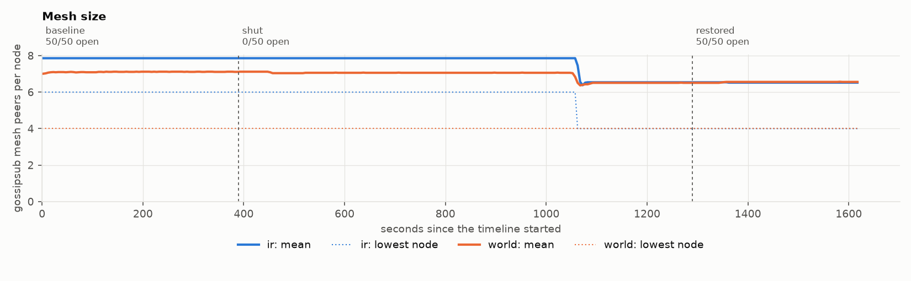

# What sets the nine minutes? Findings

In the [Iran runs](../iran-2019-11/README.md), nodes cut off from the rest of the network
kept their pre-cut mesh size for about nine minutes. That report listed a connection timeout
as a lead and did not test it. This one does, in four experiments.

Every scenario here is the same network: 50 gossipsub nodes inside and 100 outside, one full
shutdown held for 15 minutes (18 in the last experiment). The node is nim-libp2p 2.4.0 with
yamux over TCP.

## Result

**There is no nine minutes.** A cut-off node drops a dead peer at whichever of two moments
comes first:

1. **The kernel closes the TCP connection.** This is set by `net.ipv4.tcp_retries2`: 12.6 s
   at 5 retransmissions, 925 s at the default of 15.
2. **An idle check in nim-libp2p ends it.** The library runs the same periodic check at two
   layers: on each yamux stream, and on the encrypted connection beneath. Both run every
   5 minutes by default, counted from when the stream or connection was opened, and end it
   if nothing was read or written since the last check. A dead peer is therefore dropped
   5 to 10 minutes after the node last wrote to it, at a moment that depends on the
   connection's age and not on the cut.

With default settings the second comes first. The nine minutes of the earlier runs was a
5-minute limit plus the place where those scenarios happened to put the cut in the cycle of
the check. Moving the cut 150 s later, and changing nothing else, moved the reaction from
about 560 s to 678 s.

In the published node it is the stream's check that acts. Raising the stream's timeout alone
to 600 s did not delay the reaction: the connection's check then closed the same connections
at the same node age. I had predicted it would be delayed, and concluded one experiment
earlier that the stream's check was the second timer. That was too narrow.

Seconds after the cut until the inside region's mean mesh size first moved by more than 10%,
one value per valid run:

| Scenario | `tcp_retries2` | Kernel closes after | Inside mesh first moved after |
|---|---|---|---|
| cut at 240 s | 5 | 12.6 s | 20, 22, 19 |
| cut at 240 s | 8 | 102.2 s | 119, 116 |
| cut at 240 s | 10 | 324.6 s | 350, 352, 351 |
| cut at 240 s | 13 | 684.6 s | 574, 582, 554 |
| cut at 240 s | 15 (default) | 924.6 s | 577, 572, 537, 492, 567 |
| cut at 390 s | 15 (default) | 924.6 s | 677, 679, 678 |

At 5, 8 and 10 the mesh follows the kernel, 6 to 27 s behind it. At 13 and 15 the idle check
comes first.

The same cut at 240 s on a node built from source, with the yamux stream timeout as the only
difference between arms:

| Yamux stream timeout | Inside mesh first moved after |
|---|---|
| 120 s | 371, 378, and one run that never passed 10% |
| 300 s (the library's default) | 575, 533, 553 |
| 600 s | 536, 577 |

The kernel's column is its backoff rule: the retransmission timeout doubles from 200 ms, is
capped at 120 s, and the connection is closed once the time since the first retransmission
reaches the total for `tcp_retries2` retransmissions and the wait after the last.

## How it was found

**First experiment** ([METHOD.md section 10](../../docs/METHOD.md#10-follow-up-question-what-sets-the-nine-minutes)):
defaults against 5 retransmissions, three seeds each.

| # | Prediction | Result |
|---|---|---|
| P8 | With default timers, the inside mesh first moves between 480 and 660 s after the cut | Held: 537 to 577 s |
| P9 | With 5 retransmissions, it first moves within 120 s of the cut | Held: 19 to 22 s |

The first version of this report concluded from those two arms that the kernel's limit sets
the nine minutes. That was too strong. It listed as unverified which default the pods had,
and noted that 15 retransmissions should take about 925 s, not 560. A connection measured on
its own, outside this project, then closed after 951 s at the default. The conclusion could
not stand as written.

**Second experiment** ([METHOD.md section 11](../../docs/METHOD.md#11-follow-up-question-is-the-kernel-the-only-timer)):
the shaper in every pod now records the pod's own `tcp_retries2`, and three arms were added
at 8, 10 and 13, with the default run once more to record its value.

| # | Prediction | Result |
|---|---|---|
| P10 | Default pods record 15; each arm records the value it set | Held: all 150 pods in each of ten runs |
| P11 | With 8, the inside mesh first moves 100 to 140 s after the cut | Held: 116 and 119 s |
| P12 | With 10, 320 to 360 s | Held: 350 to 352 s |
| P13 | With 13, 530 to 590 s: the same as defaults, and before the kernel would close | Held: 554 to 582 s |

So there were two timers, and the second was unidentified.

**Third experiment** ([METHOD.md section 12](../../docs/METHOD.md#12-follow-up-question-is-the-second-timer-the-multiplexers-idle-check)):
reading nim-libp2p at the commit the node pins gave a candidate, the periodic idle check
described above. The stored runs fitted it: across eight of them, the later the cut came in
a node's life, the sooner the mesh reacted, and every fall came when the nodes were 919 to
958 s old. That was found after the idea, so it was written down as a reason to test and not
as a result. The test: the same scenario with the cut 150 s later, three seeds, and the
default scenario once more with the nodes' own count of idle timeouts exported.

| # | Prediction | Result |
|---|---|---|
| P14 | With the later cut, the median inside node is 900 to 975 s or 1200 to 1275 s old when its mesh first falls; with the usual cut, 900 to 975 s | Held: 1233, 1209 and 1218 s; 927 s |
| P15 | With the later cut, the inside mesh first moves less than 480 s or more than 600 s after the cut | Held: 677, 679 and 678 s |
| P16 | The inside nodes count at least 35 yamux idle timeouts from 25 s before the mesh first moves to 5 s after | Held: 2376, 1009, 2018 and 1745 |

The age at which the mesh fell, per run:

| Scenario | Node age at the cut (s) | Mesh fell after the cut (s) | Node age when it fell (s) |
|---|---|---|---|
| cut at 240 s | 369 | 562 | 927 |
| cut at 390 s, seed 1 | 557 | 677 | 1233 |
| cut at 390 s, seed 2 | 534 | 679 | 1209 |
| cut at 390 s, seed 3 | 545 | 673 | 1218 |

P16 held, but its threshold turned out to say little: the counter moves by thousands at a
time. What the counter does show is the cycle itself. In all four runs the inside nodes
closed no yamux stream for inactivity until they were about 610 to 630 s old, and then did
so in bursts whose peaks are 270 to 300 s apart. The mesh fell inside a burst every time:

| Run | Bursts of idle timeouts, seconds after the cut | Mesh first moved |
|---|---|---|
| cut at 240 s | 247 to 357, 532 to 632, 832 to 897 | 567 |
| cut at 390 s, seed 1 | 77 to 237, 372 to 537, 647 to 752 | 677 |
| cut at 390 s, seed 2 | 84 to 204, 379 to 504, 669 to 774 | 679 |
| cut at 390 s, seed 3 | 73 to 228, 368 to 523, 658 to 753 | 678 |

Counted from the nodes' start, the bursts sit at the same ages in every run. The cut landed
150 s later in that cycle, and the mesh fell one burst later.

**Fourth experiment** ([METHOD.md section 13](../../docs/METHOD.md#13-follow-up-question-does-the-reaction-move-when-the-idle-timeout-is-changed)):
the third experiment did not change the timeout it blamed. This one does. The regression
node is built from its own source with one change, a setting for the yamux stream timeout,
and run at 120, 300 and 600 s, three seeds each.

| # | Prediction | Result |
|---|---|---|
| P17 | With 300 s, the node built here behaves as the published one: mesh first moves 480 to 600 s after the cut, at a node age of 900 to 975 s | Held: 575, 533 and 553 s; 944, 949 and 935 s |
| P18 | With 120 s, the inside mesh first moves 190 to 480 s after the cut | Failed in one run of three: 371 and 378 s, and one run in which the mesh fell 8.5% and never passed 10% |
| P19 | With 600 s, it first moves more than 700 s after the cut | **Refuted:** 536 and 577 s |
| P20 | Peaks of consecutive bursts of yamux timeouts are 270 to 330 s apart with 300 s and 570 to 630 s with 600 s | Failed at 300 s: 290 and 255, 165 and 275, 330 and 260 s. Not testable at 600 s: one burst in the shutdown |

The rule written beforehand for this outcome, P17 holding and P19 failing, was that the
third experiment's conclusion is withdrawn. As it was worded, "the second timer is the
multiplexer's idle check", it is. What the runs support is narrower in one way and wider in
another.

The nodes count their idle timeouts by layer. From 30 s before the inside mesh first moved
to 60 s after:

| Arm | Mesh first moved (s) | Yamux stream timeouts | Secure connection timeouts |
|---|---|---|---|
| published node, cut at 240 s | 567 | 4215 | 19 |
| published node, cut at 390 s | 677, 679, 678 | 3812, 3444, 3696 | 0, 0, 0 |
| built node, 300 s | 575, 533, 553 | 3750, 3370, 4143 | 21, 41, 22 |
| built node, 600 s | 536, 577 | 0, 0 | 241, 152 |
| built node, 120 s | 371, 378 | 1569, 374 | 0, 1 |
| built node, 120 s, the run that never passed 10% | fell past 5% at 291 | 66 | 387 |

With the stream timeout at 600 s the mesh fell at the same node age as before, 946 and
948 s, and at that moment the nodes counted no stream timeout at all and 152 to 241 timeouts
of the secure connection. Its timeout is 5 minutes too (`DefaultConnectionTimeout`) and it
uses the same `timeoutMonitor`. So the 5-minute idle check stands, and the cycle of the
third experiment stands, but the check exists at two layers and removing one leaves the
other.

With the stream timeout at 120 s the reaction came earlier in two runs, with stream timeouts
and none of the connection's. So the stream's check is enough to cause the reaction. It is
not necessary for it.

P20 failed because a burst lasts 100 to 160 s and its peak can sit anywhere inside it. The
bursts themselves begin 275 to 300 s apart in all three runs at 300 s.

All predictions of the four experiments were pushed before the runs they describe: thirteen
predictions, of which ten held.

## What else the runs showed

**1. A node goes on writing to a dead peer for a while.** With the later cut the streams
were not reset at the second check after the cut but at the third, so the node's last
successful write to a dead peer came after the first check: more than about 75 s after the
cut. The runs with the usual cut put it under about 240 s. These bounds are inferred from node ages,
and nothing here shows what accepts those writes or why they stop.

**2. Delivery inside did not depend on any of this.** In the first experiment's two arms
every message published inside reached every inside node throughout the shutdown, and the
same held outside. A mesh that counts dead peers for nine minutes did no damage to delivery
here.

**3. Nothing sent during a 15-minute cut crossed later, in either arm.** None of the 67,500
(message, node) pairs published across the closed border in each run was delivered after it
reopened. This agrees with the ten-minute cut of the Iran runs.

**4. Recovery was immediate in both arms.** With all 50 nodes reopened at once, no message
after the reopening fell below the steady level.

**5. The network came back faster after a short timeout.** In the five minutes after
restoration, median latency from inside to outside was 286 ms with default timers and 185 ms
with 5 retransmissions, against 142 ms before the cut. From outside to inside it was 241 ms
and 143 ms, against 131 ms before. This was not predicted, so it is an observation from
three runs per arm and not a tested claim.

## What this does not establish

- **That a longer timeout delays the reaction.** Only the stream's timeout was raised, and
  the connection's took over. The connection's timeout is not a parameter of the library's
  builder, so raising both needs a change to nim-libp2p itself. Until that is run, the
  evidence that the idle check is what a default node waits for is the source, the timing,
  the counter, and one direction of intervention: a shorter stream timeout brought the
  reaction forward.
- **Why the layers traded places in one run at 120 s.** There the connection's check fired
  first, 291 s after the cut, and the mesh fell by less.
- **Why the node age at the fall drifts.** It ranges from 919 to 958 s in the runs with the
  usual cut. Streams open some time after a node starts and that time is not recorded.
- **That a NetworkPolicy cut behaves the same.** A policy that rejects packets, or a CNI
  that resets connections, would end them at once. This is a silent drop by netem.
- **Other transports.** In the source mplex has the same 5-minute default; QUIC has its own
  idle timeout. Neither was run.
- **That a shorter timeout is better.** It also closes connections sooner on a link that is
  only slow. No lossy-but-alive scenario was run with it.
- **Anything at the scale of a public network.** These are 150 nodes on one 4-CPU machine.

## Why it matters for testing

A partition test that heals after two minutes ends long before a node with default timers
has noticed anything. Mesh size, peer counts and connection counts read as healthy for the
whole split.

The time a node takes to notice is also not a property of the software alone. With
identical nodes and settings it was 492 s in one run and 679 s in another, and the
difference came from how old the nodes were when the cut landed. Two partition runs are
comparable only if the cut comes at the same node age, or if the reaction is taken out of
the idle check's hands by lowering `tcp_retries2`: at 8 or less the reaction comes within
two minutes and follows the kernel's rule to within half a minute.

Changing the muxer's timeout is not a way to control it. Raising yamux's alone changed
nothing, because the layer beneath has the same check.

## Provenance

| Arm | Report | Evidence | Valid runs |
|---|---|---|---|
| default | [default](default/report.md) | [replay run 43596346549](https://github.com/shanurwan/cut-and-heal/actions/runs/43596346549) | 3 of 3 |
| default, value recorded | [default-recorded](default-recorded/report.md) | [43629719398](https://github.com/shanurwan/cut-and-heal/actions/runs/43629719398) | 1 of 1 |
| default, timeouts counted | [default-timeouts](default-timeouts/report.md) | [43710827043](https://github.com/shanurwan/cut-and-heal/actions/runs/43710827043) | 1 of 1 |
| default, cut 150 s later | [late](late/report.md) | [43710823101](https://github.com/shanurwan/cut-and-heal/actions/runs/43710823101) | 3 of 3 |
| 5 | [short-timeout](short-timeout/report.md) | [43596356535](https://github.com/shanurwan/cut-and-heal/actions/runs/43596356535) | 3 of 3 |
| 8 | [retries-8](retries-8/report.md) | [43629704466](https://github.com/shanurwan/cut-and-heal/actions/runs/43629704466) | 2 of 3 |
| 10 | [retries-10](retries-10/report.md) | [43629709589](https://github.com/shanurwan/cut-and-heal/actions/runs/43629709589) | 3 of 3 |
| 13 | [retries-13](retries-13/report.md) | [43629714553](https://github.com/shanurwan/cut-and-heal/actions/runs/43629714553) | 3 of 3 |
| built node, yamux 120 s | [idle-120](idle-120/report.md) | [43717599103](https://github.com/shanurwan/cut-and-heal/actions/runs/43717599103) | 3 of 3 |
| built node, yamux 300 s | [idle-300](idle-300/report.md) | [43717610307](https://github.com/shanurwan/cut-and-heal/actions/runs/43717610307) | 3 of 3 |
| built node, yamux 600 s | [idle-600](idle-600/report.md) | [43717620990](https://github.com/shanurwan/cut-and-heal/actions/runs/43717620990) | 2 of 3 |

One job, one fresh K3s cluster and one seed per run, on GitHub-hosted `ubuntu-24.04` runners
(4 CPUs). The kernel setting is applied through each pod's security context and, from the
second experiment on, read back by each pod's shaper. Every number in the tables of mesh
reaction and node age is in each arm's `results.json`, produced by `cah report` on that
evidence. The bursts of idle timeouts in the third experiment and the counts by layer in the
fourth are read from `metrics/stream_timeouts_by_region.json` in each run's evidence; the
reports of the fourth experiment also list the bursts. To reproduce: Actions, *replay*, the
scenario named in each arm's report.

The built node is the regression node's source at `fb8691e` with
[one patch](../../cluster/node/yamux-idle-timeout.patch), built in each job by
`cluster/build-node.sh`. The bootstrap node is the published image in every arm.

The source read is nim-libp2p at commit `73c3637`, pinned by the lock file of the
[regression node](https://github.com/iftech/dst-libp2p-test-node): `timeoutMonitor` in
`libp2p/stream/connection.nim`, the stream timeouts in `libp2p/muxers/yamux/yamux.nim`, the
connection's in `libp2p/protocols/secure/secure.nim`, and `onPubSubPeerEvent` in
`libp2p/protocols/pubsub/gossipsub.nim`.

Every run that was started is listed here: twenty-nine runs, twenty-seven valid. Two are
withdrawn under V2, a shaper application later than the limit of 500 ms: seed 2 of the arm
at 8 retransmissions (540 ms) and seed 1 of the arm at 600 s (579 ms). The withdrawn run at
600 s first moved 544 s after the cut; it is not counted above.
