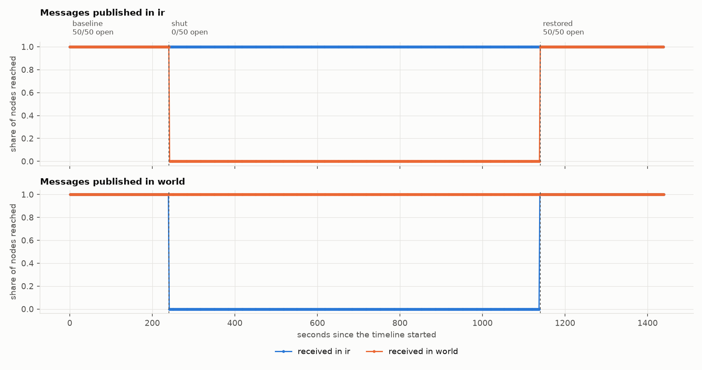
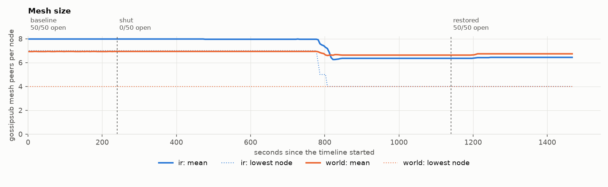

# A fifteen-minute shutdown with default TCP timers

## Setup

- 50 nodes in `ir`, 100 nodes in `world`; bootstrap node in `world`.
- Publish rate 1 msg/s, 1000 bytes, origins alternating between regions.
- System under test: `albertodst/regression-node-amd64:v2.4.0@sha256:fee857220664d269792f360734b9a819f0317dcfceeaa3edc3abd9c531a33988`.
- 1 run(s): `long-cut-seed1` (seed 1).
- A pair (message, receiving node) counts as delivered within 10 s. Steady-state figures cover the last 50% of each phase.

## Validity

| Rule | `long-cut-seed1` |
|---|---|
| V1 The run completed on the intended topology, with no pod restarts | pass |
| V2 Every pod applied every phase, on schedule | pass |
| V3 The network was healthy before anything was cut (>= 0.99) | pass |
| V4 No message was received across a border while it had no open node | pass |
| V5 The publisher kept its schedule and reached the nodes | pass |
| V6 The host had CPU headroom throughout (p95 busy <= 85%) | pass |
| V7 The evidence is complete and two records of it agree | pass |

## Delivery in steady state

Share of (message, node) pairs delivered, mean of 1 valid run(s) with the range across runs. *no path* marks a pair of regions with no open border between them in that phase. *late* is the share that arrived after the 10 s deadline, for example once a border reopened.

| Phase | Border | ir to ir | ir to world | world to ir | world to world |
|---|---|---|---|---|---|
| baseline | 50/50 open | 100.00% | 100.00% | 100.00% | 100.00% |
| shut | 0/50 open | 100.00% | 0.00% *(no path)* | 0.00% *(no path)* | 100.00% |
| restored | 50/50 open | 100.00% | 100.00% | 100.00% | 100.00% |

## Latency of delivered pairs

Median / 99th percentile, milliseconds, steady state.

| Phase | ir to ir | ir to world | world to ir | world to world |
|---|---|---|---|---|
| baseline | 31 / 61 | 138 / 203 | 130 / 202 | 78 / 237 |
| shut | 29 / 59 | n/a / n/a | n/a / n/a | 73 / 190 |
| restored | 29 / 56 | 296 / 864 | 471 / 690 | 73 / 194 |

## Time to settle after each change

Seconds from the start of a phase to the last message whose delivery was more than 1% below that phase's steady level. One value per valid run.

| Phase | ir to ir | ir to world | world to ir | world to world |
|---|---|---|---|---|
| shut | 0 | no path | no path | 0 |
| restored | 0 | 0 | 0 | 0 |

## When the mesh noticed

Seconds after each change until a region's mean mesh size first moved by more than 10%. One value per valid run; *never* means it stayed within 10% for the whole phase. The size is what each node reports about itself, so it includes peers the node has not yet found to be unreachable.

| Phase | Region | Mesh size at start | at end | Reacted after (s) |
|---|---|---|---|---|
| shut | ir | 8.0 | 6.4 | 567 |
| shut | world | 6.9 | 6.6 | never |
| restored | ir | 6.4 | 6.4 | never |
| restored | world | 6.6 | 6.7 | never |

## Mesh reaction against node age

For the pods whose own mesh fell below its size at the start of the phase: the median moment of that first fall, counted from the change and from the start of the pod's node. A reaction tied to the change keeps the first number from run to run; one tied to a clock that began with the node keeps the last.

| Run | Phase | Region | Pods | After the change (s) | Node age at the change (s) | Node age at the fall (s) |
|---|---|---|---|---|---|---|
| long-cut-seed1 | shut | ir | 47 | 562 | 369 | 927 |

## Stream idle timeouts when the mesh moved

Multiplexer streams the region's nodes closed for inactivity, from the nodes' own counter `libp2p_stream_timeouts`: from 25 s before the region's mean mesh first moved to 5 s after, and earlier in the same phase.

| Run | Phase | Region | Mesh moved after (s) | Timeouts around it | Earlier in the phase |
|---|---|---|---|---|---|
| long-cut-seed1 | shut | ir | 567 | 1745 | 9436 |

## Kernel TCP settings on the nodes

Read by each pod's shaper from the pod's own network namespace when it started. Pods per value, one column per valid run.

| Setting | long-cut-seed1 |
|---|---|
| tcp_keepalive_time | 7200 (150 pods) |
| tcp_retries2 | 15 (150 pods) |

## Figures

From run `long-cut-seed1`.

