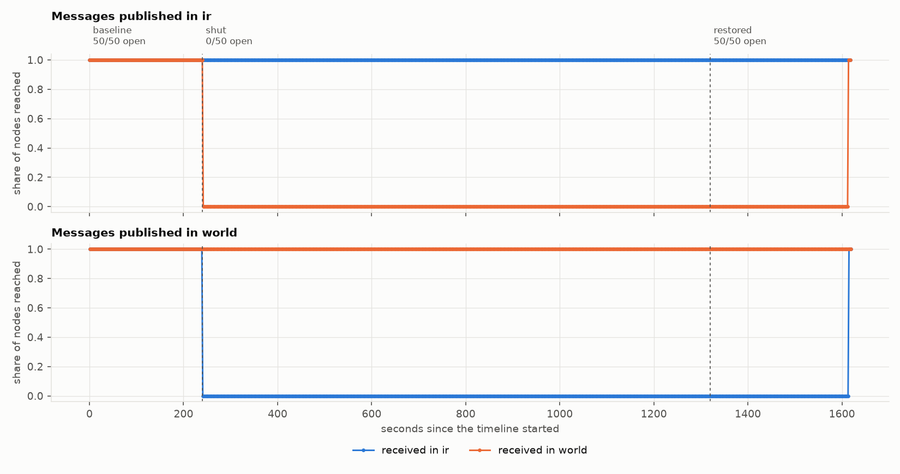
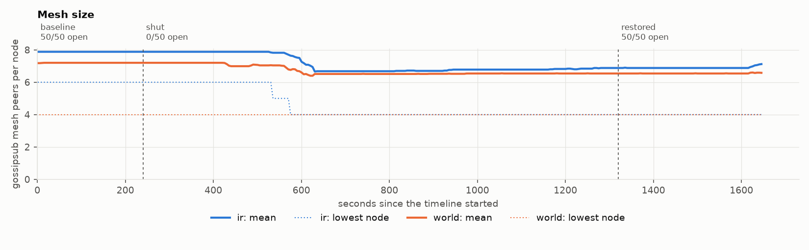

# An eighteen-minute shutdown with a yamux idle timeout of 120 s

## Setup

- 50 nodes in `ir`, 100 nodes in `world`; bootstrap node in `world`.
- Publish rate 1 msg/s, 1000 bytes, origins alternating between regions.
- System under test: `cut-and-heal-node:yamux-idle`.
- Node settings: `YAMUX_IDLE_TIMEOUT_S=120`.
- 3 run(s): `idle-check-120-seed1` (seed 1), `idle-check-120-seed2` (seed 2), `idle-check-120-seed3` (seed 3).
- A pair (message, receiving node) counts as delivered within 10 s. Steady-state figures cover the last 50% of each phase.

## Validity

| Rule | `idle-check-120-seed1` | `idle-check-120-seed2` | `idle-check-120-seed3` |
|---|---|---|---|
| V1 The run completed on the intended topology, with no pod restarts | pass | pass | pass |
| V2 Every pod applied every phase, on schedule | pass | pass | pass |
| V3 The network was healthy before anything was cut (>= 0.99) | pass | pass | pass |
| V4 No message was received across a border while it had no open node | pass | pass | pass |
| V5 The publisher kept its schedule and reached the nodes | pass | pass | pass |
| V6 The host had CPU headroom throughout (p95 busy <= 85%) | pass | pass | pass |
| V7 The evidence is complete and two records of it agree | pass | pass | pass |

## Delivery in steady state

Share of (message, node) pairs delivered, mean of 3 valid run(s) with the range across runs. *no path* marks a pair of regions with no open border between them in that phase. *late* is the share that arrived after the 10 s deadline, for example once a border reopened.

| Phase | Border | ir to ir | ir to world | world to ir | world to world |
|---|---|---|---|---|---|
| baseline | 50/50 open | 100.00% | 100.00% | 100.00% | 100.00% |
| shut | 0/50 open | 100.00% | 0.00% *(no path)* | 0.00% *(no path)* | 100.00% |
| restored | 50/50 open | 100.00% | 0.00% | 0.00% | 100.00% |

## Latency of delivered pairs

Median / 99th percentile, milliseconds, steady state.

| Phase | ir to ir | ir to world | world to ir | world to world |
|---|---|---|---|---|
| baseline | 33 / 78 | 143 / 261 | 133 / 226 | 79 / 260 |
| shut | 30 / 65 | n/a / n/a | n/a / n/a | 73 / 184 |
| restored | 30 / 63 | n/a / n/a | n/a / n/a | 72 / 176 |

## Time to settle after each change

Seconds from the start of a phase to the last message whose delivery was more than 1% below that phase's steady level. One value per valid run.

| Phase | ir to ir | ir to world | world to ir | world to world |
|---|---|---|---|---|
| shut | 0, 0, 0 | no path | no path | 0, 0, 0 |
| restored | 0, 0, 0 | 0, 0, 0 | 0, 0, 0 | 0, 0, 0 |

## When the mesh noticed

Seconds after each change until a region's mean mesh size first moved by more than 10%. One value per valid run; *never* means it stayed within 10% for the whole phase. The size is what each node reports about itself, so it includes peers the node has not yet found to be unreachable.

| Phase | Region | Mesh size at start | at end | Reacted after (s) |
|---|---|---|---|---|
| shut | ir | 7.7 | 6.9 | 371, 378, never |
| shut | world | 7.2 | 6.6 | 376, never, never |
| restored | ir | 6.9 | 6.9 | never, never, never |
| restored | world | 6.6 | 6.6 | never, never, never |

## Mesh reaction against node age

For the pods whose own mesh fell below its size at the start of the phase: the median moment of that first fall, counted from the change and from the start of the pod's node. A reaction tied to the change keeps the first number from run to run; one tied to a clock that began with the node keeps the last.

| Run | Phase | Region | Pods | After the change (s) | Node age at the change (s) | Node age at the fall (s) |
|---|---|---|---|---|---|---|
| idle-check-120-seed1 | shut | ir | 41 | 361 | 419 | 778 |
| idle-check-120-seed1 | shut | world | 68 | 353 | 407 | 759 |
| idle-check-120-seed2 | shut | ir | 39 | 373 | 388 | 760 |

## Stream idle timeouts when the mesh moved

Multiplexer streams the region's nodes closed for inactivity, from the nodes' own counter `libp2p_stream_timeouts`: from 25 s before the region's mean mesh first moved to 5 s after, and earlier in the same phase.

| Run | Phase | Region | Mesh moved after (s) | Timeouts around it | Earlier in the phase |
|---|---|---|---|---|---|
| idle-check-120-seed1 | shut | ir | 371 | 93 | 5003 |
| idle-check-120-seed1 | shut | world | 376 | 357 | 7783 |
| idle-check-120-seed2 | shut | ir | 378 | 243 | 4694 |

## Bursts of stream idle timeouts

Stretches in which a region's nodes closed multiplexer streams for inactivity, from the same counter. A burst ends after 60 s without a timeout; bursts of fewer than 100 are left out. Seconds after the phase began.

| Run | Phase | Region | From (s) | To (s) | Peak (s) | Timeouts |
|---|---|---|---|---|---|---|
| idle-check-120-seed1 | shut | ir | 1 | 6 | 1 | 250 |
| idle-check-120-seed1 | shut | ir | 101 | 1076 | 426 | 11267 |
| idle-check-120-seed1 | restored | ir | 1 | 66 | 1 | 123 |
| idle-check-120-seed1 | shut | world | 1 | 6 | 1 | 1343 |
| idle-check-120-seed1 | shut | world | 91 | 956 | 441 | 18230 |
| idle-check-120-seed1 | shut | world | 1021 | 1076 | 1036 | 2757 |
| idle-check-120-seed1 | restored | world | 1 | 116 | 91 | 1522 |
| idle-check-120-seed1 | restored | world | 211 | 296 | 286 | 696 |
| idle-check-120-seed2 | shut | ir | 108 | 648 | 458 | 9882 |
| idle-check-120-seed2 | shut | ir | 1053 | 1078 | 1058 | 546 |
| idle-check-120-seed2 | restored | ir | 3 | 38 | 8 | 260 |
| idle-check-120-seed2 | shut | world | 108 | 748 | 468 | 15917 |
| idle-check-120-seed2 | shut | world | 853 | 948 | 913 | 1380 |
| idle-check-120-seed2 | shut | world | 1048 | 1078 | 1068 | 2189 |
| idle-check-120-seed2 | restored | world | 3 | 113 | 73 | 1532 |
| idle-check-120-seed2 | restored | world | 253 | 298 | 288 | 464 |
| idle-check-120-seed3 | shut | ir | 146 | 576 | 491 | 9805 |
| idle-check-120-seed3 | restored | ir | 6 | 66 | 11 | 688 |
| idle-check-120-seed3 | shut | world | 146 | 796 | 496 | 14747 |
| idle-check-120-seed3 | shut | world | 871 | 931 | 916 | 974 |
| idle-check-120-seed3 | restored | world | 6 | 91 | 16 | 3183 |

## Kernel TCP settings on the nodes

Read by each pod's shaper from the pod's own network namespace when it started. Pods per value, one column per valid run.

| Setting | idle-check-120-seed1 | idle-check-120-seed2 | idle-check-120-seed3 |
|---|---|---|---|
| tcp_keepalive_time | 7200 (150 pods) | 7200 (150 pods) | 7200 (150 pods) |
| tcp_retries2 | 15 (150 pods) | 15 (150 pods) | 15 (150 pods) |

## Figures

From run `idle-check-120-seed1`.

