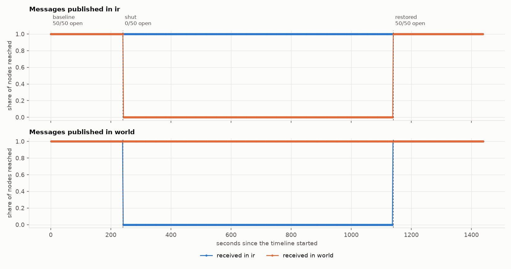
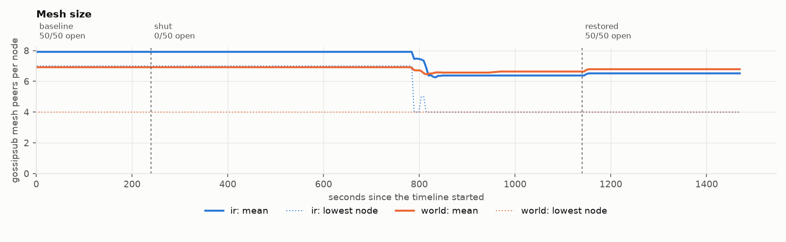

# A fifteen-minute shutdown with TCP giving up after 13 retransmissions

## Setup

- 50 nodes in `ir`, 100 nodes in `world`; bootstrap node in `world`.
- Publish rate 1 msg/s, 1000 bytes, origins alternating between regions.
- System under test: `albertodst/regression-node-amd64:v2.4.0@sha256:fee857220664d269792f360734b9a819f0317dcfceeaa3edc3abd9c531a33988`.
- 3 run(s): `long-cut-retries-13-seed1` (seed 1), `long-cut-retries-13-seed2` (seed 2), `long-cut-retries-13-seed3` (seed 3).
- A pair (message, receiving node) counts as delivered within 10 s. Steady-state figures cover the last 50% of each phase.

## Validity

| Rule | `long-cut-retries-13-seed1` | `long-cut-retries-13-seed2` | `long-cut-retries-13-seed3` |
|---|---|---|---|
| V1 The run completed on the intended topology, with no pod restarts | pass | pass | pass |
| V2 Every pod applied every phase, on schedule | pass | pass | pass |
| V3 The network was healthy before anything was cut (>= 0.99) | pass | pass | pass |
| V4 No message was received across a border while it had no open node | pass | pass | pass |
| V5 The publisher kept its schedule and reached the nodes | pass | pass | pass |
| V6 The host had CPU headroom throughout (p95 busy <= 85%) | pass | pass | pass |
| V7 The evidence is complete and two records of it agree | pass | pass | pass |

## Delivery in steady state

Share of (message, node) pairs delivered, mean of 3 valid run(s) with the range across runs. *no path* marks a pair of regions with no open border between them in that phase. *late* is the share that arrived after the 10 s deadline, for example once a border reopened.

| Phase | Border | ir to ir | ir to world | world to ir | world to world |
|---|---|---|---|---|---|
| baseline | 50/50 open | 100.00% | 100.00% | 100.00% | 100.00% |
| shut | 0/50 open | 100.00% | 0.00% *(no path)* | 0.00% *(no path)* | 100.00% |
| restored | 50/50 open | 100.00% | 100.00% | 100.00% | 100.00% |

## Latency of delivered pairs

Median / 99th percentile, milliseconds, steady state.

| Phase | ir to ir | ir to world | world to ir | world to world |
|---|---|---|---|---|
| baseline | 32 / 63 | 140 / 195 | 131 / 182 | 73 / 220 |
| shut | 29 / 61 | n/a / n/a | n/a / n/a | 70 / 174 |
| restored | 29 / 61 | 186 / 287 | 145 / 190 | 70 / 183 |

## Time to settle after each change

Seconds from the start of a phase to the last message whose delivery was more than 1% below that phase's steady level. One value per valid run.

| Phase | ir to ir | ir to world | world to ir | world to world |
|---|---|---|---|---|
| shut | 0, 0, 0 | no path | no path | 0, 0, 0 |
| restored | 0, 0, 0 | 0, 0, 0 | 0, 0, 0 | 0, 0, 0 |

## When the mesh noticed

Seconds after each change until a region's mean mesh size first moved by more than 10%. One value per valid run; *never* means it stayed within 10% for the whole phase. The size is what each node reports about itself, so it includes peers the node has not yet found to be unreachable.

| Phase | Region | Mesh size at start | at end | Reacted after (s) |
|---|---|---|---|---|
| shut | ir | 7.6 | 6.6 | 574, 582, 554 |
| shut | world | 7.1 | 6.6 | never, 592, never |
| restored | ir | 6.6 | 6.7 | never, never, never |
| restored | world | 6.6 | 6.7 | never, never, never |

## Kernel TCP settings on the nodes

Read by each pod's shaper from the pod's own network namespace when it started. Pods per value, one column per valid run.

| Setting | long-cut-retries-13-seed1 | long-cut-retries-13-seed2 | long-cut-retries-13-seed3 |
|---|---|---|---|
| tcp_keepalive_time | 7200 (150 pods) | 7200 (150 pods) | 7200 (150 pods) |
| tcp_retries2 | 13 (150 pods) | 13 (150 pods) | 13 (150 pods) |

## Figures

From run `long-cut-retries-13-seed1`.

