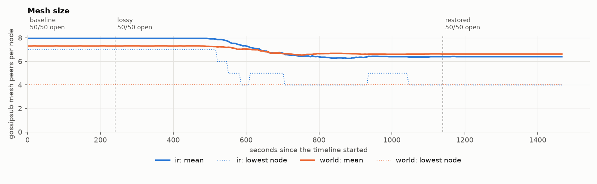
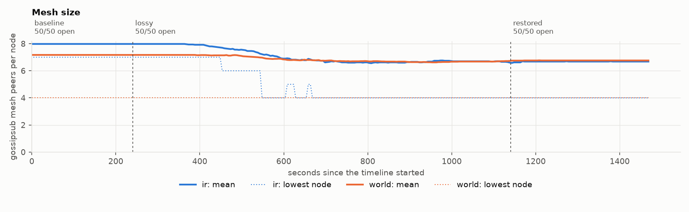

# What does a shorter TCP timeout cost on a link that is only bad? Findings

[The long-cut report](../long-cut/README.md) says that lowering `tcp_retries2` to 8 makes a
node notice a cut within two minutes. It also says this was never tried on a border that is
slow and lossy but still up, where the same setting may close connections that would have
recovered. This experiment tries it.

For 900 s the border adds 300 ms each way, loses 10% or 30% of packets each way and is
limited to 5 Mbit/s; then it is healthy again. Each loss level runs with the default kernel
and with `tcp_retries2 = 8`. The network is that of `long-cut`: 50 gossipsub nodes inside and
100 outside. The question and predictions are in
[METHOD.md section 18](../../docs/METHOD.md#18-follow-up-question-what-does-a-shorter-tcp-timeout-cost-on-a-link-that-is-only-bad).

## Result

**At 10% loss the shorter timeout costs nothing. At 30% loss the mesh loses peers with either
setting, but in different ways: the default loses some once and holds, the shorter timeout
keeps losing them for as long as the link stays bad.** Delivery held at 100% throughout in
every valid run.

| Arm | Valid runs | Delivered across the border, steady state | Median latency, inside to outside | Inside mesh first moved by >10% |
|---|---|---|---|---|
| 10% loss, default | 3 of 3 | 100% both ways | 360 to 364 ms (138 to 140 ms healthy) | never |
| 10% loss, `tcp_retries2 = 8` | 1 of 3 | 100% both ways | 367 ms (147 ms) | never |
| 30% loss, default | 1 of 3 | 100% both ways | 396 ms (141 ms) | after 376 s |
| 30% loss, `tcp_retries2 = 8` | 1 of 3 | 100% both ways | 399 ms (136 ms) | after 313 s |

How the inside nodes' connections changed during the lossy phase, from the nodes' own
counters, in the valid run of each 30% arm:

| Arm | Connected peers per inside node, start to end | Idle timeouts in the minute and a half around the mesh's move |
|---|---|---|
| 30%, default | 136 to 124, almost all lost by 480 s, then steady | none |
| 30%, `tcp_retries2 = 8` | 136 to 107, falling throughout | 4973 stream, 260 connection |

## Predictions

All three were pushed before the runs.

| # | Prediction | Result |
|---|---|---|
| P33 | With 10% loss, under either setting, the inside mean mesh does not move by more than 10%, and at least 99% are delivered within 10 s across the border | Held in all four valid runs |
| P34 | With 30% loss and `tcp_retries2 = 8`, the inside mean mesh moves by more than 10% | Held in the one valid run: after 313 s |
| P35 | With 30% loss and the default, it does not | **Refuted** in the one valid run: it moved after 376 s |

## What the runs showed

**1. A moderately bad link is harmless with either setting.** At 10% loss and 300 ms each
way, every message crossed, latency rose by the added delay, and the mesh did not change.

**2. At 30% loss something other than the kernel drops peers.** With the default kernel,
which waits about fifteen minutes before closing an unanswered connection, the inside nodes
still lost about 12 of their 136 connections within the first eight minutes, and neither
idle check fired around the mesh's move. What closed them is not identified. A candidate is the multiplexer's send
queue: at this loss a link drains slowly, and yamux resets a stream whose queue grows past
256 KB.

**3. The shorter timeout keeps eroding the network.** With `tcp_retries2 = 8` the inside
nodes lost 29 connections each over fifteen minutes and were still losing them at the end,
with thousands of idle-check resets around the mesh's move. The arithmetic of METHOD
section 18 predicted this: at 30% loss a run of seven failed retransmissions happens about
once in 110 losses.

**4. Lost connections were not made good.** Nodes dialled in short bursts during the lossy
phase, but in the shorter-timeout arm the count of connected peers still fell from start to
end. Whether those dials failed or were closed again is not separated here.

## What this does not establish

- **More than one run per arm at 30%.** Two of three runs in each 30% arm were withdrawn;
  the figures above are from one valid run each.
- **What closes connections at 30% loss with the default.** Not identified.
- **Bursty loss.** netem drops each packet independently; congested and radio links lose
  packets in bursts.
- **Lower loss than 10% or higher than 30%.**

## Why it matters

The long-cut advice to lower `tcp_retries2` needs a condition: on a link with 10% loss it is
free; on one with 30% loss it turns a one-time loss of peers into a steady drain. And at
30% loss the default is not safe either. For a test lab, a lossy-link scenario at these
levels changes the network's shape during the test, which any delivery figure from it should
say.

## Provenance

| Arm | Report | Evidence | Valid runs |
|---|---|---|---|
| 10%, default | [lossy-10](lossy-10/report.md) | [replay run 43894940915](https://github.com/shanurwan/cut-and-heal/actions/runs/43894940915) | 3 of 3 |
| 10%, `tcp_retries2 = 8` | [lossy-10-retries-8](lossy-10-retries-8/report.md) | [43894960600](https://github.com/shanurwan/cut-and-heal/actions/runs/43894960600) | 1 of 3 |
| 30%, default | [lossy-30](lossy-30/report.md) | [43894980569](https://github.com/shanurwan/cut-and-heal/actions/runs/43894980569) | 1 of 3 |
| 30%, `tcp_retries2 = 8` | [lossy-30-retries-8](lossy-30-retries-8/report.md) | [43894998846](https://github.com/shanurwan/cut-and-heal/actions/runs/43894998846) | 1 of 3 |

One job, one fresh K3s cluster and one seed per run, on GitHub-hosted `ubuntu-24.04` runners
(4 CPUs). Connection counts and idle timeouts are read from each run's
`metrics/peers_mean_by_region.json` and `metrics/stream_timeouts_by_region.json`.

Every run that was started is listed: twelve runs, six valid. The six withdrawn runs failed
V2 (a shaper more than 500 ms late), V6 (host CPU above 85% at the 95th percentile) or V5, on
a day when the runners were about twice as busy as before (see
[METHOD.md section 20](../../docs/METHOD.md#20-reruns-on-17-november)).
