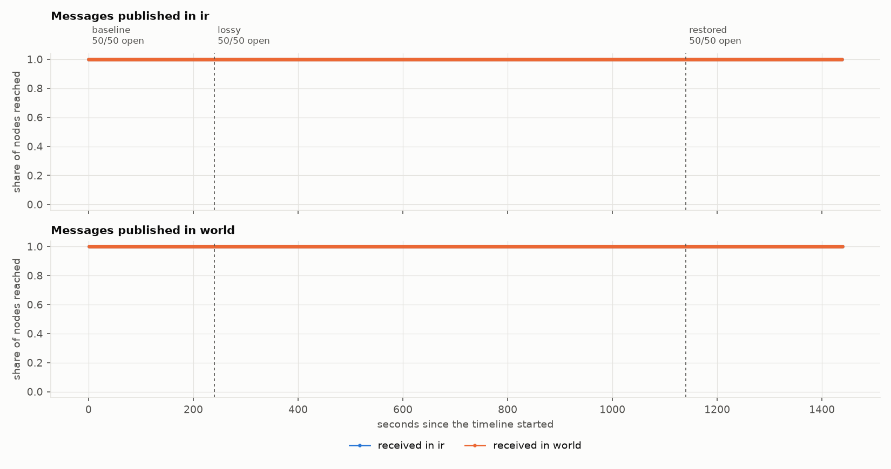
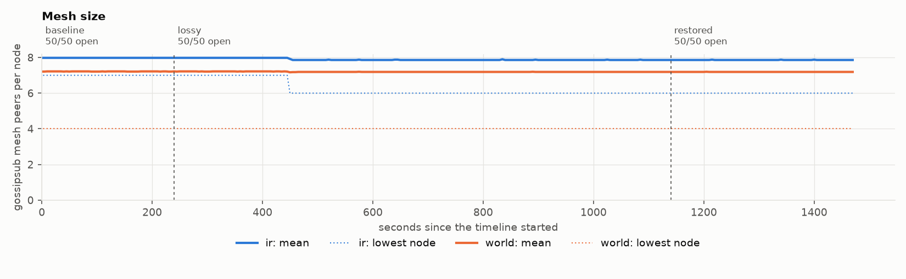

# A fifteen-minute 10% lossy border, giving up after 8 retransmissions

## Setup

- 50 nodes in `ir`, 100 nodes in `world`; bootstrap node in `world`.
- Publish rate 1 msg/s, 1000 bytes, origins alternating between regions.
- System under test: `albertodst/regression-node-amd64:v2.4.0@sha256:fee857220664d269792f360734b9a819f0317dcfceeaa3edc3abd9c531a33988`.
- 3 run(s): `lossy-10-retries-8-seed1` (seed 1), `lossy-10-retries-8-seed2` (seed 2), `lossy-10-retries-8-seed3` (seed 3).
- A pair (message, receiving node) counts as delivered within 10 s. Steady-state figures cover the last 50% of each phase.

## Validity

| Rule | `lossy-10-retries-8-seed1` | `lossy-10-retries-8-seed2` | `lossy-10-retries-8-seed3` |
|---|---|---|---|
| V1 The run completed on the intended topology, with no pod restarts | pass | pass | pass |
| V2 Every pod applied every phase, on schedule | **FAIL** | pass | **FAIL** |
| V3 The network was healthy before anything was cut (>= 0.99) | pass | pass | pass |
| V4 No message was received across a border while it had no open node | pass | pass | pass |
| V5 The publisher kept its schedule and reached the nodes | pass | pass | pass |
| V6 The host had CPU headroom throughout (p95 busy <= 85%) | pass | pass | pass |
| V7 The evidence is complete and two records of it agree | pass | pass | pass |

Run `lossy-10-retries-8-seed1` is withdrawn and contributes no numbers. V2: lateness p50 212 ms, p99 493 ms, max 501 ms over 450 applications; shaper off schedule (limit 500 ms)

Run `lossy-10-retries-8-seed3` is withdrawn and contributes no numbers. V2: lateness p50 209 ms, p99 467 ms, max 514 ms over 450 applications; shaper off schedule (limit 500 ms)

## CPU of the region machines

From each region node's cgroup, before and after the run, for every run including withdrawn ones. *Throttled* is the share of 100 ms scheduler periods in which the node had used its whole cap.

| Run | Node | Seconds | Cores used | Throttled periods | Seconds throttled |
|---|---|---|---|---|---|
| lossy-10-retries-8-seed1 | cah-ir | 1679 | 0.792 | n/a | 0.0 |
| lossy-10-retries-8-seed1 | cah-world | 1679 | 1.275 | n/a | 0.0 |
| lossy-10-retries-8-seed2 | cah-ir | 1654 | 0.819 | n/a | 0.0 |
| lossy-10-retries-8-seed2 | cah-world | 1654 | 1.34 | n/a | 0.0 |
| lossy-10-retries-8-seed3 | cah-ir | 1632 | 0.681 | n/a | 0.0 |
| lossy-10-retries-8-seed3 | cah-world | 1632 | 1.149 | n/a | 0.0 |
## Delivery in steady state

Share of (message, node) pairs delivered, mean of 1 valid run(s) with the range across runs. *no path* marks a pair of regions with no open border between them in that phase. *late* is the share that arrived after the 10 s deadline, for example once a border reopened.

| Phase | Border | ir to ir | ir to world | world to ir | world to world |
|---|---|---|---|---|---|
| baseline | 50/50 open | 100.00% | 100.00% | 100.00% | 100.00% |
| lossy | 50/50 open | 100.00% | 100.00% | 100.00% | 100.00% |
| restored | 50/50 open | 100.00% | 100.00% | 100.00% | 100.00% |

## Latency of delivered pairs

Median / 99th percentile, milliseconds, steady state.

| Phase | ir to ir | ir to world | world to ir | world to world |
|---|---|---|---|---|
| baseline | 32 / 74 | 148 / 271 | 136 / 284 | 85 / 295 |
| lossy | 33 / 71 | 367 / 478 | 348 / 407 | 82 / 220 |
| restored | 32 / 72 | 146 / 244 | 137 / 261 | 84 / 302 |

## Time to settle after each change

Seconds from the start of a phase to the last message whose delivery was more than 1% below that phase's steady level. One value per valid run.

| Phase | ir to ir | ir to world | world to ir | world to world |
|---|---|---|---|---|
| lossy | 0 | 0 | 0 | 0 |
| restored | 0 | 0 | 0 | 0 |

## When the mesh noticed

Seconds after each change until a region's mean mesh size first moved by more than 10%. One value per valid run; *never* means it stayed within 10% for the whole phase. The size is what each node reports about itself, so it includes peers the node has not yet found to be unreachable.

| Phase | Region | Mesh size at start | at end | Reacted after (s) |
|---|---|---|---|---|
| lossy | ir | 8.0 | 7.9 | never |
| lossy | world | 7.2 | 7.2 | never |
| restored | ir | 7.9 | 7.9 | never |
| restored | world | 7.2 | 7.2 | never |

## Bursts of stream idle timeouts

Stretches in which a region's nodes closed multiplexer streams for inactivity, from the same counter. A burst ends after 60 s without a timeout; bursts of fewer than 100 are left out. Seconds after the phase began.

| Run | Phase | Region | From (s) | To (s) | Peak (s) | Timeouts |
|---|---|---|---|---|---|---|
| lossy-10-retries-8-seed2 | lossy | ir | 225 | 365 | 250 | 6943 |
| lossy-10-retries-8-seed2 | lossy | ir | 520 | 665 | 565 | 1680 |
| lossy-10-retries-8-seed2 | lossy | ir | 800 | 900 | 805 | 109 |
| lossy-10-retries-8-seed2 | lossy | world | 215 | 365 | 360 | 7917 |
| lossy-10-retries-8-seed2 | lossy | world | 520 | 665 | 655 | 2350 |
| lossy-10-retries-8-seed2 | lossy | world | 800 | 900 | 810 | 411 |

## Kernel TCP settings on the nodes

Read by each pod's shaper from the pod's own network namespace when it started. Pods per value, one column per valid run.

| Setting | lossy-10-retries-8-seed2 |
|---|---|
| tcp_keepalive_time | 7200 (150 pods) |
| tcp_retries2 | 8 (150 pods) |

## Figures

From run `lossy-10-retries-8-seed2`.

