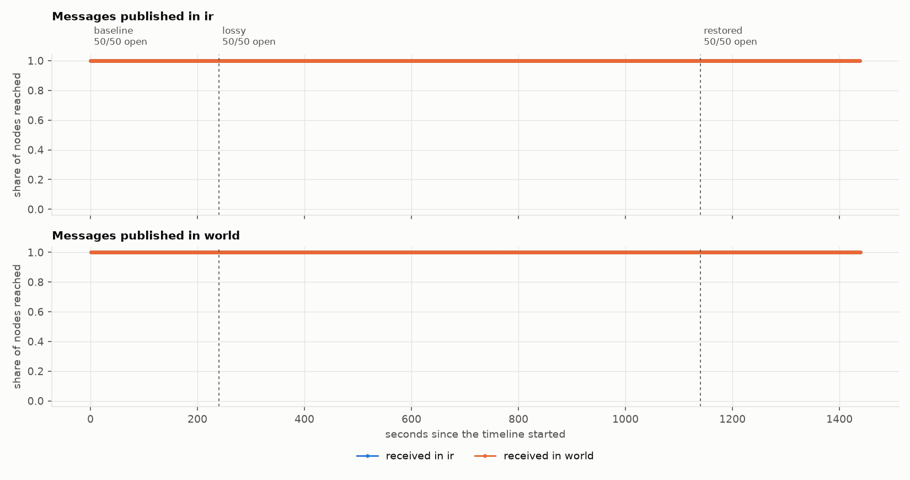
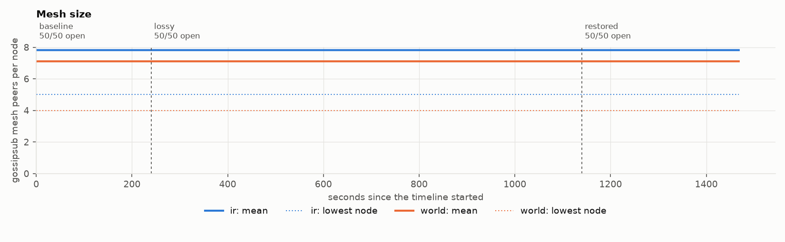

# A fifteen-minute 10% lossy border

## Setup

- 50 nodes in `ir`, 100 nodes in `world`; bootstrap node in `world`.
- Publish rate 1 msg/s, 1000 bytes, origins alternating between regions.
- System under test: `albertodst/regression-node-amd64:v2.4.0@sha256:fee857220664d269792f360734b9a819f0317dcfceeaa3edc3abd9c531a33988`.
- 3 run(s): `lossy-10-seed1` (seed 1), `lossy-10-seed2` (seed 2), `lossy-10-seed3` (seed 3).
- A pair (message, receiving node) counts as delivered within 10 s. Steady-state figures cover the last 50% of each phase.

## Validity

| Rule | `lossy-10-seed1` | `lossy-10-seed2` | `lossy-10-seed3` |
|---|---|---|---|
| V1 The run completed on the intended topology, with no pod restarts | pass | pass | pass |
| V2 Every pod applied every phase, on schedule | pass | pass | pass |
| V3 The network was healthy before anything was cut (>= 0.99) | pass | pass | pass |
| V4 No message was received across a border while it had no open node | pass | pass | pass |
| V5 The publisher kept its schedule and reached the nodes | pass | pass | pass |
| V6 The host had CPU headroom throughout (p95 busy <= 85%) | pass | pass | pass |
| V7 The evidence is complete and two records of it agree | pass | pass | pass |

## CPU of the region machines

From each region node's cgroup, before and after the run, for every run including withdrawn ones. *Throttled* is the share of 100 ms scheduler periods in which the node had used its whole cap.

| Run | Node | Seconds | Cores used | Throttled periods | Seconds throttled |
|---|---|---|---|---|---|
| lossy-10-seed1 | cah-ir | 1675 | 0.797 | n/a | 0.0 |
| lossy-10-seed1 | cah-world | 1675 | 1.213 | n/a | 0.0 |
| lossy-10-seed2 | cah-ir | 1595 | 0.636 | n/a | 0.0 |
| lossy-10-seed2 | cah-world | 1595 | 1.146 | n/a | 0.0 |
| lossy-10-seed3 | cah-ir | 1624 | 0.667 | n/a | 0.0 |
| lossy-10-seed3 | cah-world | 1624 | 1.15 | n/a | 0.0 |
## Delivery in steady state

Share of (message, node) pairs delivered, mean of 3 valid run(s) with the range across runs. *no path* marks a pair of regions with no open border between them in that phase. *late* is the share that arrived after the 10 s deadline, for example once a border reopened.

| Phase | Border | ir to ir | ir to world | world to ir | world to world |
|---|---|---|---|---|---|
| baseline | 50/50 open | 100.00% | 100.00% | 100.00% | 100.00% |
| lossy | 50/50 open | 100.00% | 100.00% | 100.00% | 100.00% |
| restored | 50/50 open | 100.00% | 100.00% | 100.00% | 100.00% |

## Latency of delivered pairs

Median / 99th percentile, milliseconds, steady state.

| Phase | ir to ir | ir to world | world to ir | world to world |
|---|---|---|---|---|
| baseline | 32 / 65 | 139 / 212 | 131 / 180 | 73 / 234 |
| lossy | 32 / 70 | 362 / 436 | 348 / 390 | 75 / 208 |
| restored | 32 / 64 | 139 / 205 | 130 / 183 | 72 / 229 |

## Time to settle after each change

Seconds from the start of a phase to the last message whose delivery was more than 1% below that phase's steady level. One value per valid run.

| Phase | ir to ir | ir to world | world to ir | world to world |
|---|---|---|---|---|
| lossy | 0, 0, 0 | 0, 0, 0 | 0, 0, 0 | 0, 0, 0 |
| restored | 0, 0, 0 | 0, 0, 0 | 0, 0, 0 | 0, 0, 0 |

## When the mesh noticed

Seconds after each change until a region's mean mesh size first moved by more than 10%. One value per valid run; *never* means it stayed within 10% for the whole phase. The size is what each node reports about itself, so it includes peers the node has not yet found to be unreachable.

| Phase | Region | Mesh size at start | at end | Reacted after (s) |
|---|---|---|---|---|
| lossy | ir | 7.8 | 7.8 | never, never, never |
| lossy | world | 7.0 | 7.0 | never, never, never |
| restored | ir | 7.8 | 7.8 | never, never, never |
| restored | world | 7.0 | 7.0 | never, never, never |

## Bursts of stream idle timeouts

Stretches in which a region's nodes closed multiplexer streams for inactivity, from the same counter. A burst ends after 60 s without a timeout; bursts of fewer than 100 are left out. Seconds after the phase began.

| Run | Phase | Region | From (s) | To (s) | Peak (s) | Timeouts |
|---|---|---|---|---|---|---|
| lossy-10-seed1 | lossy | ir | 198 | 358 | 263 | 7768 |
| lossy-10-seed1 | lossy | ir | 498 | 658 | 553 | 1763 |
| lossy-10-seed1 | lossy | ir | 783 | 898 | 788 | 119 |
| lossy-10-seed1 | lossy | world | 193 | 358 | 348 | 8407 |
| lossy-10-seed1 | lossy | world | 493 | 658 | 648 | 2289 |
| lossy-10-seed1 | lossy | world | 783 | 898 | 793 | 288 |
| lossy-10-seed1 | restored | world | 3 | 43 | 18 | 102 |
| lossy-10-seed1 | restored | world | 183 | 248 | 193 | 107 |
| lossy-10-seed2 | lossy | ir | 265 | 335 | 275 | 8996 |
| lossy-10-seed2 | lossy | ir | 560 | 635 | 575 | 1820 |
| lossy-10-seed2 | lossy | world | 265 | 335 | 325 | 10522 |
| lossy-10-seed2 | lossy | world | 560 | 635 | 630 | 2543 |
| lossy-10-seed3 | lossy | ir | 239 | 354 | 279 | 6253 |
| lossy-10-seed3 | lossy | ir | 534 | 654 | 564 | 1639 |
| lossy-10-seed3 | lossy | ir | 824 | 899 | 839 | 177 |
| lossy-10-seed3 | lossy | world | 239 | 354 | 349 | 7386 |
| lossy-10-seed3 | lossy | world | 534 | 654 | 649 | 2339 |
| lossy-10-seed3 | lossy | world | 824 | 899 | 834 | 324 |
| lossy-10-seed3 | restored | world | 224 | 259 | 234 | 125 |

## Kernel TCP settings on the nodes

Read by each pod's shaper from the pod's own network namespace when it started. Pods per value, one column per valid run.

| Setting | lossy-10-seed1 | lossy-10-seed2 | lossy-10-seed3 |
|---|---|---|---|
| tcp_keepalive_time | 7200 (150 pods) | 7200 (150 pods) | 7200 (150 pods) |
| tcp_retries2 | 15 (150 pods) | 15 (150 pods) | 15 (150 pods) |

## Figures

From run `lossy-10-seed1`.

