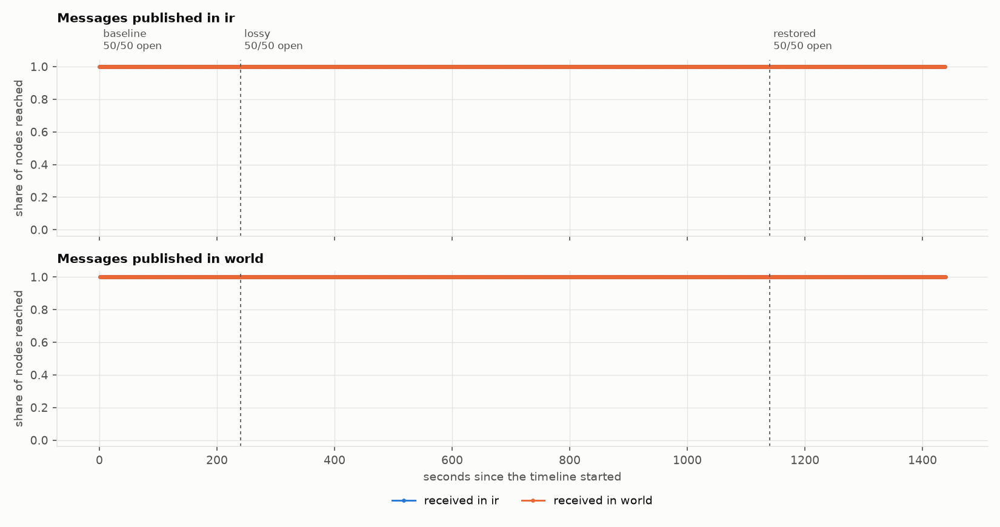
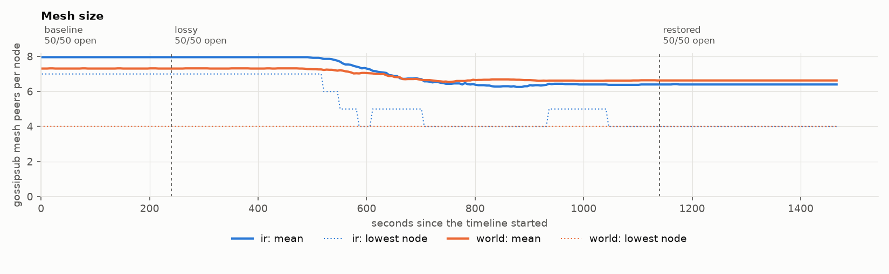

# A fifteen-minute 30% lossy border

## Setup

- 50 nodes in `ir`, 100 nodes in `world`; bootstrap node in `world`.
- Publish rate 1 msg/s, 1000 bytes, origins alternating between regions.
- System under test: `albertodst/regression-node-amd64:v2.4.0@sha256:fee857220664d269792f360734b9a819f0317dcfceeaa3edc3abd9c531a33988`.
- 3 run(s): `lossy-30-seed1` (seed 1), `lossy-30-seed2` (seed 2), `lossy-30-seed3` (seed 3).
- A pair (message, receiving node) counts as delivered within 10 s. Steady-state figures cover the last 50% of each phase.

## Validity

| Rule | `lossy-30-seed1` | `lossy-30-seed2` | `lossy-30-seed3` |
|---|---|---|---|
| V1 The run completed on the intended topology, with no pod restarts | pass | pass | pass |
| V2 Every pod applied every phase, on schedule | pass | **FAIL** | pass |
| V3 The network was healthy before anything was cut (>= 0.99) | **FAIL** | pass | pass |
| V4 No message was received across a border while it had no open node | pass | pass | pass |
| V5 The publisher kept its schedule and reached the nodes | pass | pass | pass |
| V6 The host had CPU headroom throughout (p95 busy <= 85%) | **FAIL** | **FAIL** | pass |
| V7 The evidence is complete and two records of it agree | **FAIL** | pass | pass |

Run `lossy-30-seed1` is withdrawn and contributes no numbers. V3: lowest baseline delivery 0.8367; V6: CPU busy p50 46%, p95 90%, max 100% over 298 samples; V7: 1440 publishes reconciled against 1326 node send lines; 9 logs missing; 16 log collection errors; 38060 receive lines for messages nobody logged sending; 8 pods where the controller and the node disagree on messages sent

Run `lossy-30-seed2` is withdrawn and contributes no numbers. V2: lateness p50 169 ms, p99 499 ms, max 557 ms over 450 applications; shaper off schedule (limit 500 ms); V6: CPU busy p50 65%, p95 97%, max 100% over 298 samples

## CPU of the region machines

From each region node's cgroup, before and after the run, for every run including withdrawn ones. *Throttled* is the share of 100 ms scheduler periods in which the node had used its whole cap.

| Run | Node | Seconds | Cores used | Throttled periods | Seconds throttled |
|---|---|---|---|---|---|
| lossy-30-seed1 | cah-ir | 1659 | 0.644 | n/a | 0.0 |
| lossy-30-seed1 | cah-world | 1659 | 1.299 | n/a | 0.0 |
| lossy-30-seed2 | cah-ir | 1634 | 0.973 | n/a | 0.0 |
| lossy-30-seed2 | cah-world | 1634 | 1.534 | n/a | 0.0 |
| lossy-30-seed3 | cah-ir | 1614 | 0.6 | n/a | 0.0 |
| lossy-30-seed3 | cah-world | 1614 | 1.124 | n/a | 0.0 |
## Delivery in steady state

Share of (message, node) pairs delivered, mean of 1 valid run(s) with the range across runs. *no path* marks a pair of regions with no open border between them in that phase. *late* is the share that arrived after the 10 s deadline, for example once a border reopened.

| Phase | Border | ir to ir | ir to world | world to ir | world to world |
|---|---|---|---|---|---|
| baseline | 50/50 open | 100.00% | 100.00% | 100.00% | 100.00% |
| lossy | 50/50 open | 100.00% | 100.00% | 100.00% | 100.00% |
| restored | 50/50 open | 100.00% | 100.00% | 100.00% | 100.00% |

## Latency of delivered pairs

Median / 99th percentile, milliseconds, steady state.

| Phase | ir to ir | ir to world | world to ir | world to world |
|---|---|---|---|---|
| baseline | 29 / 58 | 141 / 197 | 129 / 173 | 71 / 205 |
| lossy | 29 / 78 | 397 / 500 | 349 / 418 | 72 / 185 |
| restored | 28 / 58 | 139 / 206 | 129 / 170 | 69 / 184 |

## Time to settle after each change

Seconds from the start of a phase to the last message whose delivery was more than 1% below that phase's steady level. One value per valid run.

| Phase | ir to ir | ir to world | world to ir | world to world |
|---|---|---|---|---|
| lossy | 0 | 0 | 0 | 0 |
| restored | 0 | 0 | 0 | 0 |

## When the mesh noticed

Seconds after each change until a region's mean mesh size first moved by more than 10%. One value per valid run; *never* means it stayed within 10% for the whole phase. The size is what each node reports about itself, so it includes peers the node has not yet found to be unreachable.

| Phase | Region | Mesh size at start | at end | Reacted after (s) |
|---|---|---|---|---|
| lossy | ir | 8.0 | 6.4 | 376 |
| lossy | world | 7.3 | 6.6 | 501 |
| restored | ir | 6.4 | 6.4 | never |
| restored | world | 6.6 | 6.6 | never |

## Mesh reaction against node age

For the pods whose own mesh fell below its size at the start of the phase: the median moment of that first fall, counted from the change and from the start of the pod's node. A reaction tied to the change keeps the first number from run to run; one tied to a clock that began with the node keeps the last.

| Run | Phase | Region | Pods | After the change (s) | Node age at the change (s) | Node age at the fall (s) |
|---|---|---|---|---|---|---|
| lossy-30-seed3 | lossy | ir | 46 | 339 | 357 | 694 |
| lossy-30-seed3 | lossy | world | 72 | 339 | 355 | 697 |

## Stream idle timeouts when the mesh moved

Multiplexer streams the region's nodes closed for inactivity, from the nodes' own counter `libp2p_stream_timeouts`: from 25 s before the region's mean mesh first moved to 5 s after, and earlier in the same phase.

| Run | Phase | Region | Mesh moved after (s) | Timeouts around it | Earlier in the phase |
|---|---|---|---|---|---|
| lossy-30-seed3 | lossy | ir | 376 | 0 | 8532 |
| lossy-30-seed3 | lossy | world | 501 | 0 | 12876 |

## Bursts of stream idle timeouts

Stretches in which a region's nodes closed multiplexer streams for inactivity, from the same counter. A burst ends after 60 s without a timeout; bursts of fewer than 100 are left out. Seconds after the phase began.

| Run | Phase | Region | From (s) | To (s) | Peak (s) | Timeouts |
|---|---|---|---|---|---|---|
| lossy-30-seed3 | lossy | ir | 251 | 316 | 286 | 8138 |
| lossy-30-seed3 | lossy | ir | 546 | 616 | 561 | 1062 |
| lossy-30-seed3 | lossy | ir | 841 | 896 | 871 | 113 |
| lossy-30-seed3 | lossy | world | 251 | 316 | 256 | 12703 |
| lossy-30-seed3 | lossy | world | 546 | 616 | 556 | 2332 |
| lossy-30-seed3 | lossy | world | 841 | 896 | 876 | 287 |

## Kernel TCP settings on the nodes

Read by each pod's shaper from the pod's own network namespace when it started. Pods per value, one column per valid run.

| Setting | lossy-30-seed3 |
|---|---|
| tcp_keepalive_time | 7200 (150 pods) |
| tcp_retries2 | 15 (150 pods) |

## Figures

From run `lossy-30-seed3`.

