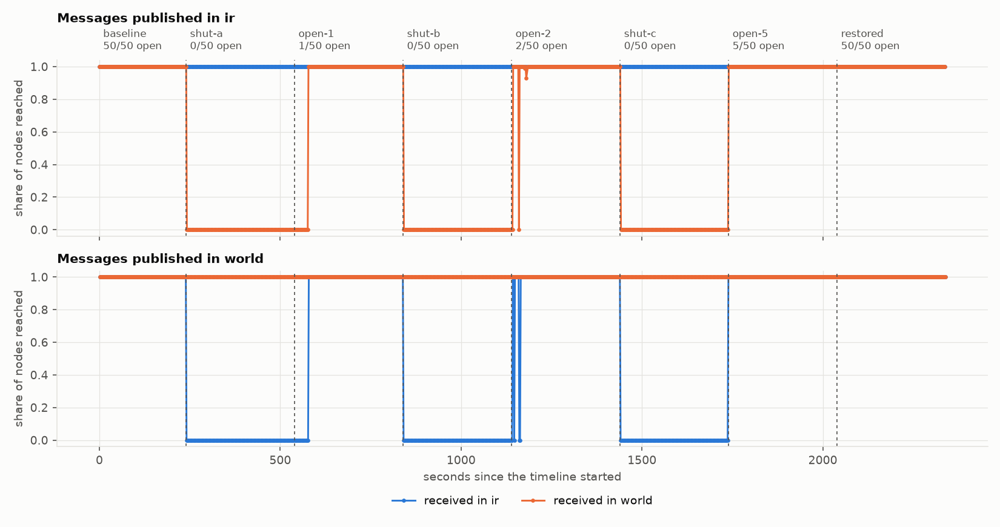

# How many open nodes does a region need? Findings

Five replicate runs of [`scenarios/open-nodes-sweep.yaml`](../../scenarios/open-nodes-sweep.yaml):
the regions and links of the Iran scenario, with the border held at 1, 2 and 5 open nodes of
50 for five minutes each, and a five-minute full shutdown before every step.

**One run passed every validity rule and four were withdrawn.** What follows is therefore
one run's result, not a replicated one. It is published because the question was left open
in the [Iran report](../iran-2019-11/README.md), and because the reason the four runs were
withdrawn is itself an observation. The generated tables and figures are in
[report.md](report.md).

## What the valid run showed

**1. One open node in fifty carried everything.** With a single inside node reconnected,
100% of messages crossed the border in both directions, to all 50 inside nodes and all 100
outside. Two and five open nodes delivered the same 100%.

**2. One node paid for it; two did not.** The single open node sent 2.3 times the bytes of
its neighbours (26.3 kB/s against 11.5 kB/s). With two open the ratio was 1.2, and with five
it was 1.4.

**3. Recovery was faster after a five-minute cut than after a ten-minute one.** Delivery
across the border settled 36 to 37 s after one node reopened, 23 to 40 s after two, and
with no measurable gap after five. In the Iran runs, two nodes reopening after a ten-minute
shutdown took about 104 s.

**4. Nothing sent during a five-minute cut was lost.** Every message published during each
of the three shutdowns reached the other side after the border reopened, late but complete.
In the Iran runs nothing published during the ten-minute shutdown ever crossed. Together
with the 60-second cut of the smoke scenario, the point where held messages are given up
lies between five and ten minutes.

**5. Crossing outward was slower with few nodes open, as before.** Median latency from
inside to outside was 142 ms at baseline and 311 to 314 ms with 1, 2 or 5 nodes open. The
other direction went from 133 ms to 147 to 164 ms.

**6. The mesh did not react to any shutdown within its five minutes.** Neither region's
mean mesh size moved by more than 10% during shut-a, shut-b or shut-c. Both moved once,
about a minute after the first reopening: inside from 7.8 to 6.7 peers after 54 s, outside
from 7.0 to 6.5 after 59 s.

## Why four runs were withdrawn

| Run | Rule | Measured | Limit |
|---|---|---|---|
| seed 1 | V5, V6 | publisher lateness p99 161 ms; CPU busy p95 98% | 50 ms; 85% |
| seed 2 | V5 | publisher lateness p99 94 ms | 50 ms |
| seed 3 | V2, V5, V6 | slowest shaper 751 ms late; publisher p99 107 ms; CPU p95 100% | 500 ms; 50 ms; 85% |
| seed 4 | V5, V6 | publisher lateness p99 123 ms; CPU p95 94% | 50 ms; 85% |
| seed 5 | none | publisher p99 45 ms; CPU p95 65%; slowest shaper 311 ms | valid |

The limits were set before these runs and were not changed.

The failures are not scattered. In all five runs, including the valid one, the late
publishes fall in the first minute after a reopening: minutes 9, 19 and 29 of the timeline,
where open-1, open-2 and open-5 begin. Between 21 and 40 of each run's 2,340 publishes were
more than 50 ms late, and the median lateness stayed at 1 to 2 ms. Host CPU was above 85%
busy in the same minutes, and again about three minutes into full restoration, where the
publisher was not affected. The Iran runs, on the same runners, had a publisher p99 of 3 ms.

So a reopening after a five-minute shutdown loads the 4-CPU host enough to disturb the
instrument that is measuring it. Seed 5 passed with 5 ms to spare. That is why this page
reports one run and does not average five.

## What this does not establish

- **That one node is enough in general.** This is one run, one seed, one choice of which
  node reopens.
- **Why the host saturates on reopening.** It coincides with the delivery of everything
  published during the shutdown (finding 4), which did not happen after the ten-minute
  shutdown in the Iran runs. That is a lead, not a verified cause.
- **Why recovery was faster here than in the Iran runs.** The shutdown was half as long and
  the held messages were delivered; either may matter, and neither was isolated.
- **A replicated answer.** That needs a design the host can carry: shorter shutdowns, a
  lower publish rate, or a larger machine, with the same limits.

## Provenance

| | |
|---|---|
| Evidence | seeds 2 to 5: [replay run 42959300484](https://github.com/shanurwan/cut-and-heal/actions/runs/42959300484); seed 1: [replay run 42964634088](https://github.com/shanurwan/cut-and-heal/actions/runs/42964634088). One job, one fresh K3s cluster and one seed per run, on GitHub-hosted `ubuntu-24.04` runners (4 CPUs) |
| Raw logs | Artifacts of those workflow runs, one per seed |
| Report | `cah report` on that evidence; every number is in [results.json](results.json) |
| Reproduce | Actions, *replay*, scenario `open-nodes-sweep`, seeds `[1, 2, 3, 4, 5]` |

Every run that was started is listed here.

| Workflow run | Runs | Outcome |
|---|---|---|
| [42959300484](https://github.com/shanurwan/cut-and-heal/actions/runs/42959300484) | seeds 1 to 5 | Seed 5 valid. Seeds 2, 3 and 4 withdrawn as in the table above. Seed 1 produced no evidence: the tool read an empty reply from the cluster as completion. Fixed in 906f41a. |
| [42964634088](https://github.com/shanurwan/cut-and-heal/actions/runs/42964634088) | seed 1 | Completed; withdrawn under V5 and V6. |
