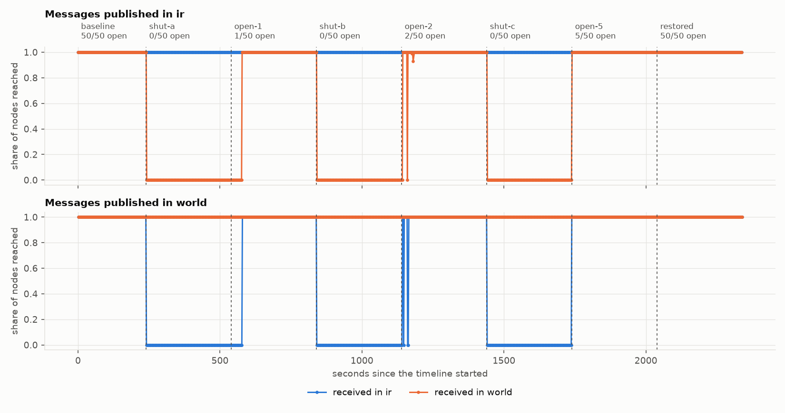
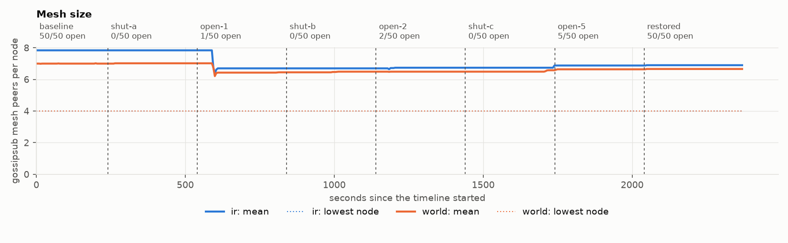
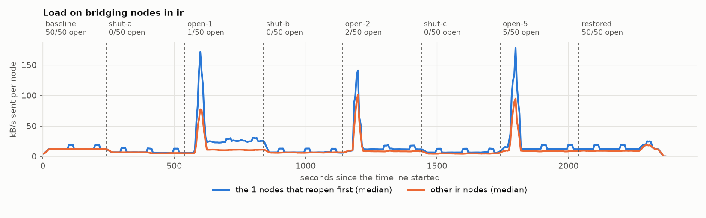

# How many open nodes does a region need? (sensitivity run for iran-2019-11)

## Setup

- 50 nodes in `ir`, 100 nodes in `world`; bootstrap node in `world`.
- Publish rate 1 msg/s, 1000 bytes, origins alternating between regions.
- System under test: `albertodst/regression-node-amd64:v2.4.0@sha256:fee857220664d269792f360734b9a819f0317dcfceeaa3edc3abd9c531a33988`.
- 5 run(s): `open-nodes-sweep-seed1` (seed 1), `open-nodes-sweep-seed2` (seed 2), `open-nodes-sweep-seed3` (seed 3), `open-nodes-sweep-seed4` (seed 4), `open-nodes-sweep-seed5` (seed 5).
- A pair (message, receiving node) counts as delivered within 10 s. Steady-state figures cover the last 50% of each phase.

## Validity

| Rule | `open-nodes-sweep-seed1` | `open-nodes-sweep-seed2` | `open-nodes-sweep-seed3` | `open-nodes-sweep-seed4` | `open-nodes-sweep-seed5` |
|---|---|---|---|---|---|
| V1 The run completed on the intended topology, with no pod restarts | pass | pass | pass | pass | pass |
| V2 Every pod applied every phase, on schedule | pass | pass | **FAIL** | pass | pass |
| V3 The network was healthy before anything was cut (>= 0.99) | pass | pass | pass | pass | pass |
| V4 No message was received across a border while it had no open node | pass | pass | pass | pass | pass |
| V5 The publisher kept its schedule and reached the nodes | **FAIL** | **FAIL** | **FAIL** | **FAIL** | pass |
| V6 The host had CPU headroom throughout (p95 busy <= 85%) | **FAIL** | pass | **FAIL** | **FAIL** | pass |
| V7 The evidence is complete and two records of it agree | pass | pass | pass | pass | pass |

Run `open-nodes-sweep-seed1` is withdrawn and contributes no numbers. V5: 2340 publishes, send lateness p99 161 ms, 0 never reached a node, 0 refused by the node for having no peers (an outcome, not a fault); V6: CPU busy p50 35%, p95 98%, max 100% over 478 samples

Run `open-nodes-sweep-seed2` is withdrawn and contributes no numbers. V5: 2340 publishes, send lateness p99 94 ms, 0 never reached a node, 0 refused by the node for having no peers (an outcome, not a fault)

Run `open-nodes-sweep-seed3` is withdrawn and contributes no numbers. V2: lateness p50 106 ms, p99 251 ms, max 751 ms over 1200 applications; shaper off schedule (limit 500 ms); V5: 2340 publishes, send lateness p99 107 ms, 0 never reached a node, 0 refused by the node for having no peers (an outcome, not a fault); V6: CPU busy p50 36%, p95 100%, max 100% over 478 samples

Run `open-nodes-sweep-seed4` is withdrawn and contributes no numbers. V5: 2340 publishes, send lateness p99 123 ms, 0 never reached a node, 0 refused by the node for having no peers (an outcome, not a fault); V6: CPU busy p50 35%, p95 94%, max 100% over 478 samples

## Delivery in steady state

Share of (message, node) pairs delivered, mean of 1 valid run(s) with the range across runs. *no path* marks a pair of regions with no open border between them in that phase. *late* is the share that arrived after the 10 s deadline, for example once a border reopened.

| Phase | Border | ir to ir | ir to world | world to ir | world to world |
|---|---|---|---|---|---|
| baseline | 50/50 open | 100.00% | 100.00% | 100.00% | 100.00% |
| shut-a | 0/50 open | 100.00% | 0.00%, 100.0% late *(no path)* | 0.00%, 100.0% late *(no path)* | 100.00% |
| open-1 | 1/50 open | 100.00% | 100.00% | 100.00% | 100.00% |
| shut-b | 0/50 open | 100.00% | 0.00%, 100.0% late *(no path)* | 0.00%, 100.0% late *(no path)* | 100.00% |
| open-2 | 2/50 open | 100.00% | 100.00% | 100.00% | 100.00% |
| shut-c | 0/50 open | 100.00% | 0.00%, 100.0% late *(no path)* | 0.00%, 100.0% late *(no path)* | 100.00% |
| open-5 | 5/50 open | 100.00% | 100.00% | 100.00% | 100.00% |
| restored | 50/50 open | 100.00% | 100.00% | 100.00% | 100.00% |

## Latency of delivered pairs

Median / 99th percentile, milliseconds, steady state.

| Phase | ir to ir | ir to world | world to ir | world to world |
|---|---|---|---|---|
| baseline | 33 / 69 | 142 / 207 | 133 / 207 | 74 / 228 |
| shut-a | 29 / 61 | n/a / n/a | n/a / n/a | 70 / 182 |
| open-1 | 29 / 62 | 312 / 524 | 162 / 313 | 70 / 168 |
| shut-b | 29 / 66 | n/a / n/a | n/a / n/a | 71 / 166 |
| open-2 | 28 / 62 | 314 / 509 | 164 / 301 | 70 / 161 |
| shut-c | 29 / 63 | n/a / n/a | n/a / n/a | 70 / 164 |
| open-5 | 29 / 61 | 311 / 400 | 147 / 220 | 71 / 192 |
| restored | 31 / 102 | 211 / 2899 | 142 / 277 | 78 / 2701 |

## Time to settle after each change

Seconds from the start of a phase to the last message whose delivery was more than 1% below that phase's steady level. One value per valid run.

| Phase | ir to ir | ir to world | world to ir | world to world |
|---|---|---|---|---|
| shut-a | 0 | no path | no path | 0 |
| open-1 | 0 | 36 | 37 | 0 |
| shut-b | 0 | no path | no path | 0 |
| open-2 | 0 | 40.24 | 23 | 0 |
| shut-c | 0 | no path | no path | 0 |
| open-5 | 0 | 0 | 0 | 0 |
| restored | 0 | 0 | 0 | 0 |

## When the mesh noticed

Seconds after each change until a region's mean mesh size first moved by more than 10%. One value per valid run; *never* means it stayed within 10% for the whole phase. The size is what each node reports about itself, so it includes peers the node has not yet found to be unreachable.

| Phase | Region | Mesh size at start | at end | Reacted after (s) |
|---|---|---|---|---|
| shut-a | ir | 7.8 | 7.8 | never |
| shut-a | world | 7.0 | 7.0 | never |
| open-1 | ir | 7.8 | 6.7 | 54 |
| open-1 | world | 7.0 | 6.5 | 59 |
| shut-b | ir | 6.7 | 6.7 | never |
| shut-b | world | 6.5 | 6.5 | never |
| open-2 | ir | 6.7 | 6.7 | never |
| open-2 | world | 6.5 | 6.5 | never |
| shut-c | ir | 6.7 | 6.9 | never |
| shut-c | world | 6.5 | 6.6 | never |
| open-5 | ir | 6.9 | 6.9 | never |
| open-5 | world | 6.6 | 6.6 | never |
| restored | ir | 6.9 | 6.9 | never |
| restored | world | 6.6 | 6.7 | never |

## Load on the nodes that keep the border

Median bytes sent per second in steady state: nodes with the border open against the other nodes of their region. One row per valid run.

| Phase | Open nodes | Open nodes (B/s) | Other nodes (B/s) | Ratio |
|---|---|---|---|---|
| open-1 | 1 | 26342 | 11528 | 2.29 |
| open-2 | 2 | 10294 | 8651 | 1.19 |
| open-5 | 5 | 12099 | 8520 | 1.42 |

## Figures

From run `open-nodes-sweep-seed5`.

