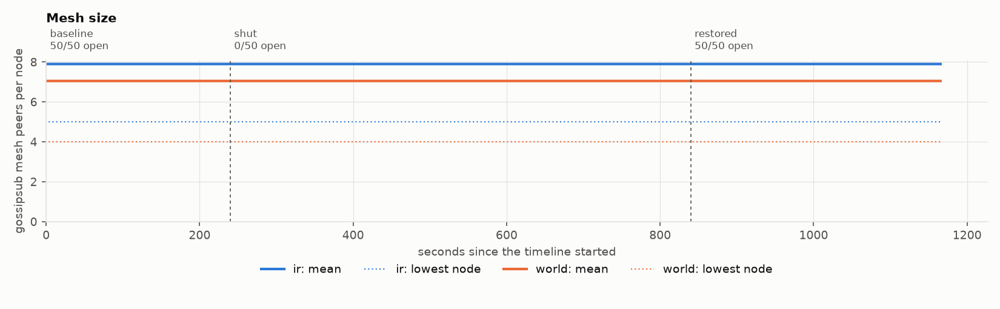

# Does a NetworkPolicy partition a running mesh? Findings

A partition test in a Kubernetes lab is often made with NetworkPolicies: label the two sides
and allow each to talk only to itself. Every other cut in this project is made with netem,
which drops every packet of the closed border at a set time. This experiment shuts the same
border with policies instead and asks whether the mesh notices. The question and predictions
are in [METHOD.md section 17](../../docs/METHOD.md#17-lab-question-does-a-networkpolicy-partition-a-running-mesh),
the probe and P39 in [section 20](../../docs/METHOD.md#20-reruns-on-17-november).

The network is that of `long-cut`: 50 gossipsub nodes inside and 100 outside. For 600 s the
controller holds one policy per side that allows traffic only within that side. The cluster
is K3s, whose policies are enforced by its built-in controller, kube-router, with flannel.

## Result

**On this cluster a NetworkPolicy does not partition a running gossipsub mesh. It stops new
connections across the border and leaves the existing ones alone, and those carry every
message.** For ten minutes with the border "shut", 100% of messages crossed in both
directions at the same latency as before, and the mesh never moved.

| | Six valid runs of six |
|---|---|
| Policies accepted by the API server | 24 of 24, asked within 21 ms of the phase starting, answered in 5 to 107 ms |
| Messages across the border while shut | 100% both ways, in every run |
| Median latency across, before / while shut | 141 / 140 ms inside to outside, 130 / 130 ms outside to inside |
| Inside mesh moved | never |
| Fresh TCP connections across the border while shut | 0 of 343 connected, every one refused |
| Fresh connections before and after | 297 of 297 connected |

The probe ran in seeds 4 to 6: every 10 s the first pod of each region opened a new TCP
connection across the border, with a 3 s limit.

## Predictions

All three were pushed before the runs they judge.

| # | Prediction | Result |
|---|---|---|
| P31 | The API server accepts every policy within 1 s of the phase starting | Held in all six runs |
| P32 | In the shut phase at least 90% of pairs across the border are delivered within 10 s, both ways, every run | Held in all six runs: 100% |
| P39 | Every probe in the shut phase fails, every probe outside it connects | Held in all three runs with the probe |

## What the runs showed

**1. The policy was enforced.** No fresh connection crossed in ten minutes, in either
direction. The connection was refused, not left unanswered, so a client that dials learns at
once that the peer is unreachable.

**2. Only for new connections.** The connections each node already had, about 130 to 140,
kept carrying traffic. kube-router puts a rule that accepts packets of established connections at the head
of every pod's firewall chain, ahead of the policy rules
([`pod.go`](https://github.com/cloudnativelabs/kube-router/blob/0ee763bf05e40bdefb6f0c317eab69270b7c6b23/pkg/controllers/netpol/pod.go#L248-L254)),
and rejects what no policy allows.

**3. Gossipsub needed nothing else.** The nodes dialled nobody during the cut, so nothing
they needed was refused. A ten-minute netem cut of the same network loses everything sent
during it (see [cut-length](../cut-length/README.md)); this one lost nothing.

**4. Some connections were lost, and not replaced.** In the runs with node counters (seeds 4
to 6), the mean connected peers per inside node fell during the cut, from 138 to 119, 140 to
136 and 134 to 132, and per outside node from 131 to 93 in one run; then stayed there after
the policies were removed. No dial failed. Which connections closed, and whether they
crossed the border, is not separated here; mesh connections were not among them.

## What this does not establish

- **Cilium or Kube-OVN.** The DST lab runs those; they may treat existing connections
  differently, and nothing here is measured on them.
- **Whether 10ksim's partition is affected.** It splits a network with policies too. If they
  are applied before the nodes connect, existing connections do not matter. When it applies
  them was not tested.
- **A longer cut.** Ten minutes with traffic every second. An idle connection would still
  be ended by nim-libp2p's idle check, which the steady traffic here kept from firing.

## Why it matters

A partition test can pass for the wrong reason. If the cut is a policy applied to a running
network, the mesh may never be cut at all, and a result of "no loss during the partition"
then describes an intact network. Such a test should check that the cut held: a fresh
connection across it fails, and messages stop crossing. Ending the existing connections,
by restarting the pods or dropping packets as netem does, makes the cut real.

## Provenance

| Seeds | Evidence | Valid runs |
|---|---|---|
| 1 to 3 | [replay run 43894923158](https://github.com/shanurwan/cut-and-heal/actions/runs/43894923158) | 3 of 3 |
| 4 to 6, with the probe | [43906900840](https://github.com/shanurwan/cut-and-heal/actions/runs/43906900840) | 3 of 3 |

One job, one fresh K3s cluster and one seed per run, on GitHub-hosted `ubuntu-24.04` runners
(4 CPUs). [report.md](report.md) and `results.json` were produced by one `cah report` over
all six runs. For this scenario rule V4 is a measurement, not a validity rule: whether
traffic crosses a policy is the question.
