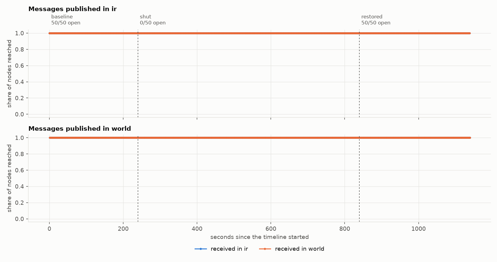
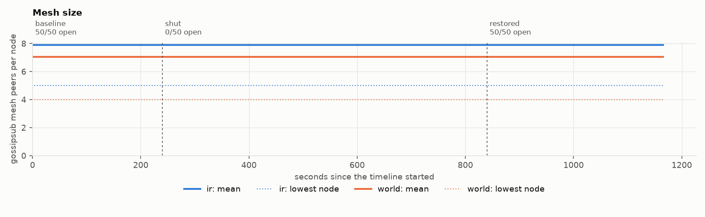

# A ten-minute shutdown made with NetworkPolicies

## Setup

- 50 nodes in `ir`, 100 nodes in `world`; bootstrap node in `world`.
- Publish rate 1 msg/s, 1000 bytes, origins alternating between regions.
- System under test: `albertodst/regression-node-amd64:v2.4.0@sha256:fee857220664d269792f360734b9a819f0317dcfceeaa3edc3abd9c531a33988`.
- Borders shut by: Kubernetes NetworkPolicy (see `policy.py`).
- 6 run(s): `policy-cut-seed1` (seed 1), `policy-cut-seed2` (seed 2), `policy-cut-seed3` (seed 3), `policy-cut-seed4` (seed 4), `policy-cut-seed5` (seed 5), `policy-cut-seed6` (seed 6).
- Runner of `policy-cut-seed4`: 4 CPUs, AMD EPYC 9V74 80-Core Processor , kernel 7.0.0-1017-azure.
- Runner of `policy-cut-seed5`: 4 CPUs, Intel(R) Xeon(R) 6975P-C , kernel 7.0.0-1014-aws.
- Runner of `policy-cut-seed6`: 4 CPUs, Intel(R) Xeon(R) 6975P-C , kernel 7.0.0-1014-aws.
- A pair (message, receiving node) counts as delivered within 10 s. Steady-state figures cover the last 50% of each phase.

## Validity

| Rule | `policy-cut-seed1` | `policy-cut-seed2` | `policy-cut-seed3` | `policy-cut-seed4` | `policy-cut-seed5` | `policy-cut-seed6` |
|---|---|---|---|---|---|---|
| V1 The run completed on the intended topology, with no pod restarts | pass | pass | pass | pass | pass | pass |
| V2 Every pod applied every phase, on schedule | pass | pass | pass | pass | pass | pass |
| V3 The network was healthy before anything was cut (>= 0.99) | pass | pass | pass | pass | pass | pass |
| V4 No message was received across a border while it had no open node | pass | pass | pass | pass | pass | pass |
| V5 The publisher kept its schedule and reached the nodes | pass | pass | pass | pass | pass | pass |
| V6 The host had CPU headroom throughout (p95 busy <= 85%) | pass | pass | pass | pass | pass | pass |
| V7 The evidence is complete and two records of it agree | pass | pass | pass | pass | pass | pass |

## CPU of the region machines

From each region node's cgroup, before and after the run, for every run including withdrawn ones. *Throttled* is the share of 100 ms scheduler periods in which the node had used its whole cap.

| Run | Node | Seconds | Cores used | Throttled periods | Seconds throttled |
|---|---|---|---|---|---|
| policy-cut-seed1 | cah-ir | 1309 | 0.636 | n/a | 0.0 |
| policy-cut-seed1 | cah-world | 1309 | 1.129 | n/a | 0.0 |
| policy-cut-seed2 | cah-ir | 1302 | 0.549 | n/a | 0.0 |
| policy-cut-seed2 | cah-world | 1302 | 1.0 | n/a | 0.0 |
| policy-cut-seed3 | cah-ir | 1377 | 0.838 | n/a | 0.0 |
| policy-cut-seed3 | cah-world | 1377 | 1.36 | n/a | 0.0 |
| policy-cut-seed4 | cah-ir | 1333 | 0.823 | n/a | 0.0 |
| policy-cut-seed4 | cah-world | 1333 | 1.316 | n/a | 0.0 |
| policy-cut-seed5 | cah-ir | 1296 | 0.648 | n/a | 0.0 |
| policy-cut-seed5 | cah-world | 1296 | 1.141 | n/a | 0.0 |
| policy-cut-seed6 | cah-ir | 1292 | 0.564 | n/a | 0.0 |
| policy-cut-seed6 | cah-world | 1292 | 1.021 | n/a | 0.0 |

## Fresh connections across the border

Every 10 s the first pod of each region opened a new TCP connection across the border, with a 3 s limit; the first 20 s of each phase are left out. *No answer* is a silent drop, *refused* a refusal or error.

| Run | Pod | Phase | Target | Tried | Connected | No answer | Refused |
|---|---|---|---|---|---|---|---|
| policy-cut-seed4 | ir-0 | baseline | bootstrap:5000 | 22 | 22 | 0 | 0 |
| policy-cut-seed4 | ir-0 | shut | bootstrap:5000 | 57 | 0 | 0 | 57 |
| policy-cut-seed4 | ir-0 | restored | bootstrap:5000 | 28 | 28 | 0 | 0 |
| policy-cut-seed4 | world-0 | baseline | ir-0.nodes:5000 | 21 | 21 | 0 | 0 |
| policy-cut-seed4 | world-0 | shut | ir-0.nodes:5000 | 58 | 0 | 0 | 58 |
| policy-cut-seed4 | world-0 | restored | ir-0.nodes:5000 | 27 | 27 | 0 | 0 |
| policy-cut-seed5 | ir-0 | baseline | bootstrap:5000 | 22 | 22 | 0 | 0 |
| policy-cut-seed5 | ir-0 | shut | bootstrap:5000 | 57 | 0 | 0 | 57 |
| policy-cut-seed5 | ir-0 | restored | bootstrap:5000 | 28 | 28 | 0 | 0 |
| policy-cut-seed5 | world-0 | baseline | ir-0.nodes:5000 | 22 | 22 | 0 | 0 |
| policy-cut-seed5 | world-0 | shut | ir-0.nodes:5000 | 57 | 0 | 0 | 57 |
| policy-cut-seed5 | world-0 | restored | ir-0.nodes:5000 | 27 | 27 | 0 | 0 |
| policy-cut-seed6 | ir-0 | baseline | bootstrap:5000 | 22 | 22 | 0 | 0 |
| policy-cut-seed6 | ir-0 | shut | bootstrap:5000 | 57 | 0 | 0 | 57 |
| policy-cut-seed6 | ir-0 | restored | bootstrap:5000 | 28 | 28 | 0 | 0 |
| policy-cut-seed6 | world-0 | baseline | ir-0.nodes:5000 | 22 | 22 | 0 | 0 |
| policy-cut-seed6 | world-0 | shut | ir-0.nodes:5000 | 57 | 0 | 0 | 57 |
| policy-cut-seed6 | world-0 | restored | ir-0.nodes:5000 | 28 | 28 | 0 | 0 |

## NetworkPolicy requests

Each policy the controller created or deleted: how late after the phase began it asked, how long the API server took to answer, and the HTTP status. When the network plugin enforced it is read from the deliveries, not from here.

| Run | Phase | Policy | Action | Asked after (ms) | API answered in (ms) | Status |
|---|---|---|---|---|---|---|
| policy-cut-seed1 | shut | cut-ir-world-ir | create | 2 | 19 | 201 |
| policy-cut-seed1 | shut | cut-ir-world-world | create | 21 | 6 | 201 |
| policy-cut-seed1 | restored | cut-ir-world-ir | delete | 1 | 16 | 200 |
| policy-cut-seed1 | restored | cut-ir-world-world | delete | 17 | 5 | 200 |
| policy-cut-seed2 | shut | cut-ir-world-ir | create | 2 | 9 | 201 |
| policy-cut-seed2 | shut | cut-ir-world-world | create | 11 | 6 | 201 |
| policy-cut-seed2 | restored | cut-ir-world-ir | delete | 2 | 12 | 200 |
| policy-cut-seed2 | restored | cut-ir-world-world | delete | 14 | 5 | 200 |
| policy-cut-seed3 | shut | cut-ir-world-ir | create | 2 | 15 | 201 |
| policy-cut-seed3 | shut | cut-ir-world-world | create | 17 | 13 | 201 |
| policy-cut-seed3 | restored | cut-ir-world-ir | delete | 1 | 15 | 200 |
| policy-cut-seed3 | restored | cut-ir-world-world | delete | 16 | 107 | 200 |
| policy-cut-seed4 | shut | cut-ir-world-ir | create | 2 | 13 | 201 |
| policy-cut-seed4 | shut | cut-ir-world-world | create | 15 | 8 | 201 |
| policy-cut-seed4 | restored | cut-ir-world-ir | delete | 2 | 13 | 200 |
| policy-cut-seed4 | restored | cut-ir-world-world | delete | 15 | 9 | 200 |
| policy-cut-seed5 | shut | cut-ir-world-ir | create | 2 | 13 | 201 |
| policy-cut-seed5 | shut | cut-ir-world-world | create | 15 | 6 | 201 |
| policy-cut-seed5 | restored | cut-ir-world-ir | delete | 1 | 13 | 200 |
| policy-cut-seed5 | restored | cut-ir-world-world | delete | 14 | 6 | 200 |
| policy-cut-seed6 | shut | cut-ir-world-ir | create | 1 | 16 | 201 |
| policy-cut-seed6 | shut | cut-ir-world-world | create | 17 | 9 | 201 |
| policy-cut-seed6 | restored | cut-ir-world-ir | delete | 1 | 13 | 200 |
| policy-cut-seed6 | restored | cut-ir-world-world | delete | 14 | 8 | 200 |
## Delivery in steady state

Share of (message, node) pairs delivered, mean of 6 valid run(s) with the range across runs. *no path* marks a pair of regions with no open border between them in that phase. *late* is the share that arrived after the 10 s deadline, for example once a border reopened.

| Phase | Border | ir to ir | ir to world | world to ir | world to world |
|---|---|---|---|---|---|
| baseline | 50/50 open | 100.00% | 100.00% | 100.00% | 100.00% |
| shut | 0/50 open | 100.00% | 100.00% *(no path)* | 100.00% *(no path)* | 100.00% |
| restored | 50/50 open | 100.00% | 100.00% | 100.00% | 100.00% |

## Latency of delivered pairs

Median / 99th percentile, milliseconds, steady state.

| Phase | ir to ir | ir to world | world to ir | world to world |
|---|---|---|---|---|
| baseline | 31 / 65 | 141 / 211 | 130 / 179 | 74 / 221 |
| shut | 31 / 65 | 140 / 210 | 130 / 180 | 74 / 218 |
| restored | 31 / 64 | 141 / 212 | 130 / 188 | 74 / 223 |

## Time to settle after each change

Seconds from the start of a phase to the last message whose delivery was more than 1% below that phase's steady level. One value per valid run.

| Phase | ir to ir | ir to world | world to ir | world to world |
|---|---|---|---|---|
| shut | 0, 0, 0, 0, 0, 0 | no path | no path | 0, 0, 0, 0, 0, 0 |
| restored | 0, 0, 0, 0, 0, 0 | 0, 0, 0, 0, 0, 0 | 0, 0, 0, 0, 0, 0 | 0, 0, 0, 0, 0, 0 |

## When the mesh noticed

Seconds after each change until a region's mean mesh size first moved by more than 10%. One value per valid run; *never* means it stayed within 10% for the whole phase. The size is what each node reports about itself, so it includes peers the node has not yet found to be unreachable.

| Phase | Region | Mesh size at start | at end | Reacted after (s) |
|---|---|---|---|---|
| shut | ir | 7.9 | 7.9 | never, never, never, never, never, never |
| shut | world | 7.0 | 7.0 | never, never, never, never, never, never |
| restored | ir | 7.9 | 7.9 | never, never, never, never, never, never |
| restored | world | 7.0 | 7.0 | never, never, never, never, never, never |

## Messages sent while a border was shut

Of the messages published in one region while it had no path to another, the share of (message, node) pairs in the other region delivered by the end of the run, and when, in seconds after the path reopened. *During* is the share that crossed while the border was meant to be shut. The last column is when the sending region's mean mesh first moved by more than 10% during the shutdown, if it did.

| Run | Phase | From | To | Shut (s) | Messages | During | Delivered later | First (s) | Median (s) | Last (s) | Sender's mesh moved after (s) |
|---|---|---|---|---|---|---|---|---|---|---|---|
| policy-cut-seed1 | shut | ir | world | 600 | 299 | 100.00% | 0.00% |  |  |  | never |
| policy-cut-seed1 | shut | world | ir | 600 | 299 | 100.00% | 0.00% |  |  |  | never |
| policy-cut-seed2 | shut | ir | world | 600 | 299 | 100.00% | 0.00% |  |  |  | never |
| policy-cut-seed2 | shut | world | ir | 600 | 299 | 100.00% | 0.00% |  |  |  | never |
| policy-cut-seed3 | shut | ir | world | 600 | 299 | 100.00% | 0.00% |  |  |  | never |
| policy-cut-seed3 | shut | world | ir | 600 | 299 | 100.00% | 0.00% |  |  |  | never |
| policy-cut-seed4 | shut | ir | world | 600 | 299 | 100.00% | 0.00% |  |  |  | never |
| policy-cut-seed4 | shut | world | ir | 600 | 299 | 100.00% | 0.00% |  |  |  | never |
| policy-cut-seed5 | shut | ir | world | 600 | 299 | 100.00% | 0.00% |  |  |  | never |
| policy-cut-seed5 | shut | world | ir | 600 | 299 | 100.00% | 0.00% |  |  |  | never |
| policy-cut-seed6 | shut | ir | world | 600 | 299 | 100.00% | 0.00% |  |  |  | never |
| policy-cut-seed6 | shut | world | ir | 600 | 299 | 100.00% | 0.00% |  |  |  | never |

## Bursts of stream idle timeouts

Stretches in which a region's nodes closed multiplexer streams for inactivity, from the same counter. A burst ends after 60 s without a timeout; bursts of fewer than 100 are left out. Seconds after the phase began.

| Run | Phase | Region | From (s) | To (s) | Peak (s) | Timeouts |
|---|---|---|---|---|---|---|
| policy-cut-seed1 | shut | ir | 260 | 335 | 260 | 6404 |
| policy-cut-seed1 | shut | ir | 555 | 595 | 580 | 1141 |
| policy-cut-seed1 | restored | ir | 0 | 30 | 10 | 187 |
| policy-cut-seed1 | shut | world | 260 | 335 | 320 | 9270 |
| policy-cut-seed1 | shut | world | 555 | 595 | 575 | 945 |
| policy-cut-seed1 | restored | world | 0 | 30 | 25 | 1228 |
| policy-cut-seed1 | restored | world | 245 | 295 | 250 | 141 |
| policy-cut-seed2 | shut | ir | 265 | 335 | 275 | 6908 |
| policy-cut-seed2 | shut | ir | 560 | 600 | 575 | 1415 |
| policy-cut-seed2 | restored | ir | 5 | 30 | 10 | 168 |
| policy-cut-seed2 | shut | world | 265 | 335 | 325 | 9433 |
| policy-cut-seed2 | shut | world | 560 | 600 | 590 | 1257 |
| policy-cut-seed2 | restored | world | 5 | 30 | 25 | 960 |
| policy-cut-seed3 | shut | ir | 207 | 362 | 212 | 5655 |
| policy-cut-seed3 | shut | ir | 502 | 597 | 542 | 1019 |
| policy-cut-seed3 | restored | ir | 2 | 62 | 47 | 233 |
| policy-cut-seed3 | shut | world | 202 | 362 | 352 | 6870 |
| policy-cut-seed3 | shut | world | 502 | 597 | 597 | 464 |
| policy-cut-seed3 | restored | world | 2 | 62 | 47 | 1425 |
| policy-cut-seed3 | restored | world | 177 | 297 | 187 | 406 |
| policy-cut-seed4 | shut | ir | 232 | 372 | 277 | 5469 |
| policy-cut-seed4 | shut | ir | 527 | 597 | 557 | 766 |
| policy-cut-seed4 | restored | ir | 2 | 72 | 47 | 469 |
| policy-cut-seed4 | restored | ir | 217 | 282 | 222 | 195 |
| policy-cut-seed4 | shut | world | 227 | 372 | 362 | 6730 |
| policy-cut-seed4 | shut | world | 532 | 597 | 577 | 217 |
| policy-cut-seed4 | restored | world | 2 | 72 | 52 | 1757 |
| policy-cut-seed4 | restored | world | 217 | 297 | 277 | 354 |
| policy-cut-seed5 | shut | ir | 268 | 343 | 278 | 6749 |
| policy-cut-seed5 | shut | ir | 563 | 598 | 578 | 1107 |
| policy-cut-seed5 | restored | ir | 3 | 43 | 3 | 231 |
| policy-cut-seed5 | shut | world | 268 | 343 | 328 | 9304 |
| policy-cut-seed5 | shut | world | 563 | 598 | 588 | 760 |
| policy-cut-seed5 | restored | world | 3 | 43 | 33 | 1344 |
| policy-cut-seed6 | shut | ir | 273 | 333 | 288 | 6432 |
| policy-cut-seed6 | shut | ir | 568 | 598 | 583 | 1193 |
| policy-cut-seed6 | restored | ir | 3 | 28 | 3 | 219 |
| policy-cut-seed6 | shut | world | 273 | 333 | 323 | 9508 |
| policy-cut-seed6 | shut | world | 568 | 598 | 583 | 1056 |
| policy-cut-seed6 | restored | world | 3 | 33 | 23 | 1120 |

## Kernel TCP settings on the nodes

Read by each pod's shaper from the pod's own network namespace when it started. Pods per value, one column per valid run.

| Setting | policy-cut-seed1 | policy-cut-seed2 | policy-cut-seed3 | policy-cut-seed4 | policy-cut-seed5 | policy-cut-seed6 |
|---|---|---|---|---|---|---|
| tcp_keepalive_time | 7200 (150 pods) | 7200 (150 pods) | 7200 (150 pods) | 7200 (150 pods) | 7200 (150 pods) | 7200 (150 pods) |
| tcp_retries2 | 15 (150 pods) | 15 (150 pods) | 15 (150 pods) | 15 (150 pods) | 15 (150 pods) | 15 (150 pods) |

## Figures

From run `policy-cut-seed1`.

